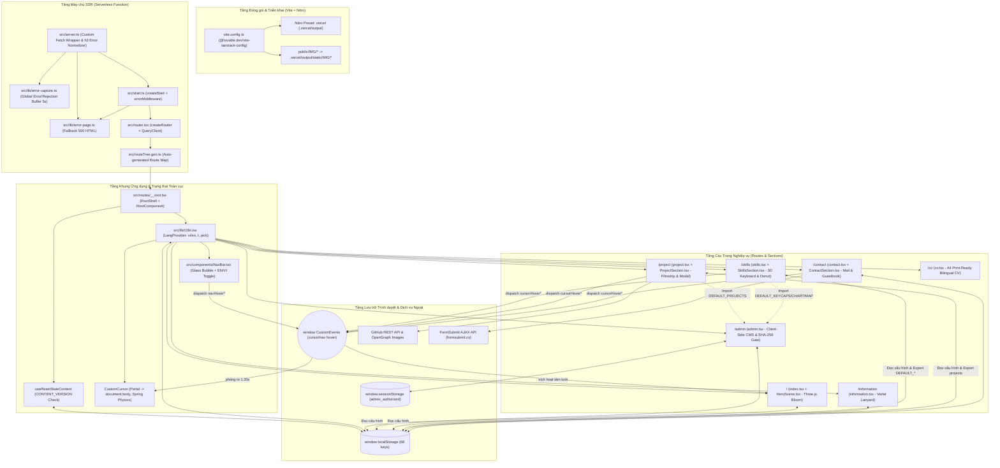
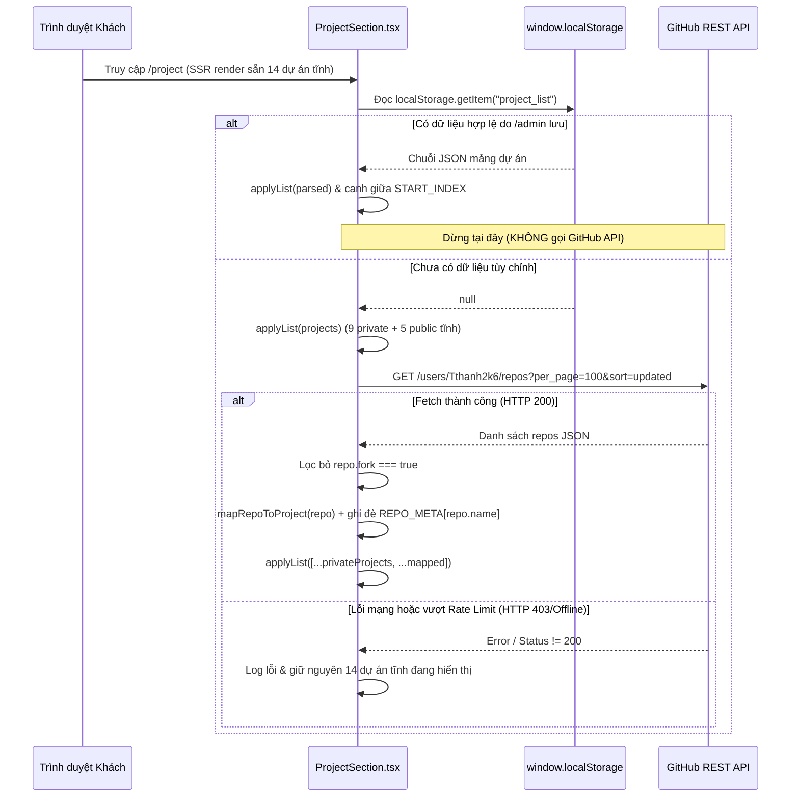
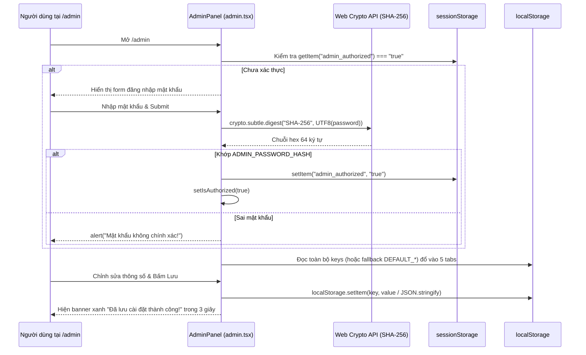
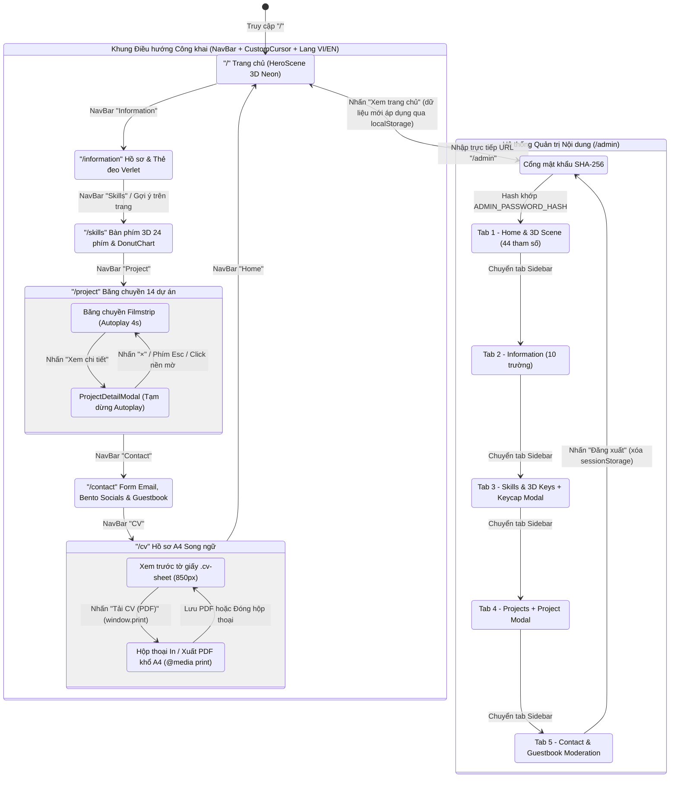

# TÀI LIỆU KIẾN TRÚC & MÃ NGUỒN TOÀN DIỆN — DỰ ÁN PORTFOLIO

> **Dự án:** Trần Trung Thành · Interactive 3D & Full-Stack Portfolio (`tanstack_start_ts`)  
> **Đường dẫn gốc:** `d:\Project\Portfolio`  
> ** Kho lưu trữ Git:** `https://github.com/Tthanh2k6/Portfolio.git` (nhánh `main`)  
> **Nền tảng triển khai:** Vercel (thông qua TanStack Start SSR + Nitro preset `vercel`)

---

## 1. Tổng quan Dự án (Project Overview)

### 1.1. Bài toán thực tế, Đối tượng sử dụng & Bối cảnh vận hành

Dự án **Portfolio** là website giới thiệu năng lực cá nhân, hồ sơ nghề nghiệp, hệ thống kỹ năng chuyên môn, danh mục dự án thực tế (bao gồm cả sản phẩm thương mại đang vận hành và dự án mã nguồn mở) cùng kênh liên hệ tương tác của tác giả **Trần Trung Thành** (Full-stack & Mobile Developer, sinh viên ngành Khoa học Máy tính tại Đại học Công nghiệp TP.HCM — IUH).

Thay vì xây dựng một trang thông tin tĩnh đơn điệu, dự án giải quyết đồng thời 4 bài toán thực tế:

1. **Tạo ấn tượng thị giác & chứng minh năng lực kỹ thuật ngay trên giao diện:** Tích hợp đồ họa WebGL 3D thời gian thực (`Three.js` + `UnrealBloomPass`), mô phỏng vật lý dây đeo thẻ bằng tích phân Verlet (`Verlet Integration`), bàn phím cơ 3D CSS tương tác kết hợp biểu đồ tròn nổ lát (`SVG Donut Chart`), con trỏ chuột biến dạng giọt nước theo vận tốc lò xo giảm chấn, và băng chuyền cuộn phim vô hạn (`Infinite Film-Strip Carousel`).
2. **Phục vụ đa nhóm đối tượng độc giả bằng mô tả phân tầng & song ngữ Việt – Anh (`VI` / `EN`):**
   - **Khách truy cập phổ thông / Khách hàng:** Đọc mô tả ngắn gọn 2–3 dòng (`desc` / `descEn`) ngay trên thẻ dự án, giải thích sản phẩm giải quyết việc gì bằng ngôn ngữ đời thường.
   - **Nhà tuyển dụng / Kỹ sư trưởng (Tech Lead):** Mở hộp thoại chi tiết (`ProjectDetailModal` qua trường `detail` / `detailEn`) để đọc sâu về kiến trúc hệ thống, quyết định kỹ thuật, cách xử lý sự cố thực tế và các đánh đổi (trade-offs); đồng thời xem hoặc xuất trực tiếp hồ sơ **CV chuẩn khổ giấy A4** sang PDF tại đường dẫn `/cv`.
3. **Đảm bảo khả năng lập chỉ mục (SEO) và tải trang tức thì nhờ Server-Side Rendering (SSR):** Vận hành trên nền **TanStack Start** và **TanStack Router**, kết xuất sẵn HTML đầy đủ nội dung mặc định từ phía máy chủ và đồng bộ trạng thái an toàn khi hydrate phía trình duyệt.
4. **Cá nhân hóa & thử nghiệm giao diện tức thời không cần backend riêng:** Cung cấp bảng điều khiển quản trị phía trình duyệt tại `/admin` (lưu trữ qua `localStorage`), cho phép tinh chỉnh trực tiếp văn bản, thông số vật lý/ánh sáng cảnh 3D, danh sách phím kỹ năng, dự án, mạng xã hội và sổ lưu bút cục bộ, đi kèm cơ chế đánh phiên bản dữ liệu (`CONTENT_VERSION`) để không làm kẹt dữ liệu cũ sau mỗi đợt cập nhật mã nguồn.

### 1.2. Lịch sử Tiến hóa Kiến trúc (Từ `Idea Demo/` lên `TanStack Start`)

Trong kho mã nguồn vẫn lưu giữ thư mục `Idea Demo/` chứa 5 tệp HTML độc lập (`Home.html`, `Info.html`, `skills.html`, `Project.html`, `Contact.html`). Đây là các bản phác thảo thiết kế giao diện và nguyên mẫu thuật toán ban đầu (sử dụng HTML/CSS/JS thuần, dữ liệu giả lập mẫu). Khi chuyển sang ứng dụng chính thức trong `src/`, tác giả đã tái cấu trúc toàn diện:

- Hợp nhất thành ứng dụng đa trang định tuyến theo tệp (`file-based routing`) trên **TanStack Start + React 19 + TypeScript**.
- Chuyển con trỏ tùy biến và thanh điều hướng bong bóng kính mờ (`NavBar`) thành thành phần dùng chung toàn cục.
- Thay toàn bộ dữ liệu mẫu Web3/Fintech giả lập bằng **14 dự án thực tế** (9 dự án thực chiến không công khai mã nguồn + 5 dự án công khai kết hợp tự động gọi GitHub REST API của tài khoản `Tthanh2k6`) và **24 kỹ năng thực chiến**.
- Bổ sung trang `/cv` chuyên biệt cho in ấn PDF A4, trang `/admin` đồng bộ nguồn dữ liệu đơn (`Single Source of Truth`), và hệ thống song ngữ `src/lib/i18n.tsx`.

### 1.3. Bảng Tech Stack Chi tiết

Toàn bộ phiên bản dưới đây được trích xuất chính xác từ `package.json`:

| Nhóm công nghệ | Thư viện / Công cụ | Phiên bản (`package.json`) | Vai trò trong dự án |
| :--- | :--- | :--- | :--- |
| **Runtime & Ngôn ngữ** | Node.js | `>= 22.12` (theo `README.md` & lockfile) | Môi trường chạy dev server, build Vite và hàm serverless SSR |
| | TypeScript | `^5.8.3` | Kiểm tra kiểu tĩnh (`strict: true`, `target: ES2022`, `moduleResolution: Bundler`) |
| **Core UI & SSR Framework** | `react` / `react-dom` | `^19.2.0` | Thư viện dựng giao diện người dùng và kết xuất SSR / Portal |
| | `@tanstack/react-start` | `^1.167.50` | Full-stack React framework xử lý SSR, middleware server và hydration |
| | `@tanstack/react-router` | `^1.168.25` | Định tuyến client/server kiểu an toàn (type-safe file-based routing) |
| | `@tanstack/router-plugin` | `^1.167.28` | Plugin tự động quét `src/routes/` để sinh `src/routeTree.gen.ts` |
| | `@tanstack/react-query` | `^5.83.0` | Quản lý context dữ liệu bất đồng bộ gắn với Router context (`QueryClient`) |
| **Server & Đóng gói** | `vite` | `^8.0.16` | Công cụ bundler và máy chủ phát triển tốc độ cao |
| | `nitro` | `3.0.260603-beta` | Động cơ đóng gói máy chủ SSR theo preset `vercel` (`.vercel/output`) |
| | `@lovable.dev/vite-tanstack-config` | `^2.5.2` | Bộ cấu hình tích hợp sẵn Vite + TanStack Start + React + Tailwind + Nitro |
| | `@vitejs/plugin-react` | `^5.2.0` | Biên dịch JSX và Fast Refresh cho React |
| | `vite-tsconfig-paths` | `^6.0.2` | Ánh xạ đường dẫn alias `@/*` trỏ về `./src/*` |
| **Đồ họa 3D & Chuyển động** | `three` | `^0.184.0` | Dựng cảnh 3D WebGL isometric neon grid, raycasting, `UnrealBloomPass`, `LineSegments2` |
| | `framer-motion` | `^12.40.0` | Hoạt ảnh xuất hiện tuần tự mượt mà cho văn bản trang chủ |
| **Styling & Design System** | `tailwindcss` | `^4.2.1` | Framework CSS tiện ích thế hệ v4 (`@theme inline`, hệ màu `oklch`) |
| | `@tailwindcss/vite` | `^4.2.1` | Plugin tích hợp trực tiếp Tailwind CSS v4 vào Vite |
| | `tw-animate-css` | `^1.3.4` | Thư viện tiện ích hoạt ảnh mở rộng cho Tailwind CSS v4 |
| **Chất lượng Mã nguồn** | `eslint` / `typescript-eslint` | `^9.32.0` / `^8.56.1` | Kiểm tra quy tắc mã nguồn, React Hooks và chặn import `server-only` sai chuẩn |
| | `prettier` | `^3.7.3` | Định dạng mã nguồn thống nhất (`printWidth: 100`, `singleQuote: false`) |

### 1.4. Thông tin Kho mã nguồn Git

- **Remote URL (`origin`):** `https://github.com/Tthanh2k6/Portfolio.git` (`fetch` & `push`)
- **Nhánh hiện tại:** `main` (đồng bộ với `remotes/origin/main`, cây làm việc sạch `git status --short` trống)
- **Các mốc commit phát triển gần nhất (`git log`):**

| Mã Commit | Nội dung thay đổi |
| :--- | :--- |
| `2fa7899` | `docs: update README` |
| `a4c11af` | `Thêm dự án ToolPhone, Sổ thu chi và NCKH-PeopleCount vào danh sách dự án cá nhân` |
| `936ae33` | `Bản tiếng Anh cho toàn site, đổi ngôn ngữ bằng nút EN/VI trên NavBar` |
| `2fc47b1` | `Tách mô tả 2 tầng + thêm modal "Xem chi tiết" cho dự án` |
| `535a46f` | `CV: điền số điện thoại, bỏ hẳn mục GPA` |
| `4ce9830` | `Thêm ảnh thật cho 4 dự án, link Google Play, sửa layout trang Skills` |
| `6ab3aa4` | `Bổ sung dự án thật vào portfolio, gộp nguồn dữ liệu chung cho admin` |
| `ece4728` | `Update README and component descriptions for clarity and AI integration details` |
| `274eddb` | `Implement refactoring of core modules for improved performance and maintainability` |
| `ff9265c` | `Adjust bubble positioning in NavBar for accurate alignment with links` |
| `25b09f7` | `Chuyển IMG vào public/ để ảnh được build & phục vụ đúng trên Vercel` |
| `ac419c4` | `Xóa file cấu hình AGENTS.md không còn dùng` |
| `c51471c` | `Cấu hình nitro preset vercel để deploy lên Vercel` |
| `5f56968` | `Hoàn thiện portfolio: dọn dependencies, dịch comment, tích hợp dự án GitHub` |
| `357f1c3` | `Add skills portfolio page with interactive 3D keyboard and typewriter effect` |

---

## 2. Kiến trúc Tổng thể & Luồng Dữ liệu (Architecture & End-to-End Data Flow)

### 2.1. Sơ đồ Kiến trúc Tổng thể



### 2.2. Phân tích Các Tầng Kiến trúc & Cơ chế Giao tiếp

1. **Tầng Máy chủ SSR & Bảo vệ Lỗi Hai Lớp (`src/server.ts`, `src/start.ts`, `src/lib/error-*.ts`):**
   - Mọi HTTP request đầu tiên đi vào hàm `fetch(request, env, ctx)` của `src/server.ts` (được khai báo qua `tanstackStart.server.entry = "server"` trong `vite.config.ts`).
   - `src/server.ts` nạp lười (`lazy dynamic import`) `@tanstack/react-start/server-entry` một lần duy nhất vào biến `serverEntryPromise`.
   - Bên trong pipeline TanStack Start, `errorMiddleware` (`src/start.ts`) bọc toàn bộ quá trình xử lý route: nếu có lỗi ném ra mà không mang thuộc tính `"statusCode"` (tức không phải lỗi HTTP có chủ đích như redirect/404), middleware bắt lại và trả về trang HTML tĩnh thân thiện từ `renderErrorPage()`.
   - Nếu lỗi xảy ra sâu trong tầng `h3` khiến `h3` tự nuốt exception và trả về JSON `{"unhandled":true,"message":"HTTPError"}` kèm mã HTTP 500, hàm `normalizeCatastrophicSsrResponse` trong `src/server.ts` sẽ phát hiện mẫu JSON này, khôi phục stack trace thật nhờ `consumeLastCapturedError()` (`src/lib/error-capture.ts`) để ghi ra `console.error`, rồi thay thế bằng trang HTML `renderErrorPage()`.

2. **Tầng App Shell & Đồng bộ Phiên bản Nội dung (`src/routes/__root.tsx`):**
   - `RootShell` dựng khung tài liệu `<html>`, `<HeadContent />` (chứa meta, Google Fonts theo từng trang, và stylesheet `styles.css?url`) cùng `<Scripts />`.
   - `RootComponent` bọc cây ứng dụng trong `<QueryClientProvider>` và `<LangProvider>`, hiển thị route con qua `<Outlet />` và gắn `<CustomCursor />` vào `document.body` bằng `createPortal`.
   - Hook `useResetStaleContent()` đối chiếu khóa `localStorage["content_version"]` với hằng số `CONTENT_VERSION = "2026-08-06-2"` nhằm tự động dọn sạch 4 khóa dữ liệu cấu trúc cũ nếu mã nguồn vừa cập nhật danh sách dự án/kỹ năng mới.

3. **Tầng Đa ngôn ngữ Phản ứng (`src/lib/i18n.tsx`):**
   - Cung cấp Context `LangContext` cho toàn bộ các trang thông qua hook `useLang()`.
   - Đảm bảo tính nhất quán SSR–Client bằng cách luôn khởi tạo `lang = "vi"` ở lần render đầu tiên, sau đó mới đọc `localStorage["site_lang"]` trong `useEffect`.

4. **Tầng Giao tiếp Sự kiện Giao diện Phi tập trung (`window.dispatchEvent`):**
   - Để tránh truyền callback qua nhiều tầng props hoặc gây re-render React mỗi khi rê chuột (60–144Hz), dự án sử dụng cơ chế bắn `CustomEvent` trực tiếp trên `window`:
     - `cursorHoverEnter` / `cursorHoverLeave`: các thẻ dự án, phím 3D, ô nhập liệu và nút bấm phát tín hiệu để `CustomCursor` trong `__root.tsx` phóng mượt kích thước lên `1.35x` hoặc thu về `1.0x`.
     - `navHoverEnter` / `navHoverLeave`: `NavBar` phát tín hiệu khi con trỏ đi vào thanh menu để `HeroScene` giả lập tọa độ chuột tại tâm `(0, 0, 0)`, làm các khối neon giữa màn hình đồng loạt nhô lên.

5. **Tầng CMS Phía Trình duyệt & Chia sẻ Nguồn Dữ liệu Mặc định (`admin.tsx` ↔ `ProjectSection.tsx` / `SkillsSection.tsx`):**
   - Không nhân bản mảng dữ liệu: `ProjectSection.tsx` xuất hằng `projects`, còn `SkillsSection.tsx` xuất `KEYCAPS`, `CHART_DATA`, `TITLE_TO_CHART`. Trang `/admin` import trực tiếp các hằng này làm giá trị khởi tạo (`DEFAULT_*`), đảm bảo trang quản trị và trang công khai luôn dùng chung một nguồn dữ liệu gốc duy nhất.

### 2.3. Vòng đời Khởi động Ứng dụng (Startup Lifecycle)

1. **Pha 1 — Kết xuất trên Server (SSR):**
   - Request GET (ví dụ `/project` hoặc `/skills`) đi qua `src/server.ts` → `src/start.ts` (`errorMiddleware`) → `getRouter()` (`src/router.tsx`) khởi tạo `QueryClient` và `Router` từ `routeTree`.
   - `RootShell` và `RootComponent` chạy trên server: các `useEffect` chưa kích hoạt, `LangProvider` giữ `lang = "vi"`, `CustomCursor` trả về `null` (do `mounted === false`), `SkillsSection` và `ProjectSection` kết xuất sẵn danh sách kỹ năng và dự án mặc định bằng tiếng Việt vào HTML trả về cho trình duyệt (tối ưu cho bot tìm kiếm và trình đọc CV). Riêng `index.tsx` trì hoãn phần chữ Framer Motion cho tới khi `mounted === true` trên client.
2. **Pha 2 — Hydrate & Đồng bộ Trạng thái Client:**
   - Trình duyệt tải bundle JS và hydrate cây React khớp hoàn toàn với HTML từ server.
   - Các `useEffect` tại `RootComponent` chạy trước/cùng lúc:
     1. `useResetStaleContent()` kiểm tra `content_version`; nếu khác `"2026-08-06-2"`, xóa `project_list`, `skills_keycaps`, `skills_chart_data`, `skills_title_to_chart` và ghi lại phiên bản mới.
     2. `LangProvider` đọc `localStorage["site_lang"]`; nếu là `"en"`, chuyển toàn bộ giao diện sang tiếng Anh.
     3. `CustomCursor` bật `mounted = true`, gắn portal vào `document.body` và khởi chạy vòng lặp vật lý `requestAnimationFrame`.
   - Component của trang đích đọc các khóa `localStorage` tương ứng (nếu có) và khởi tạo engine đồ họa/vật lý (`Three.js` trên `/`, `Verlet` trên `/information`, bàn phím 3D trên `/skills`, carousel + fetch GitHub trên `/project`).

### 2.4. Chi tiết Tất cả Các Luồng Nghiệp vụ Chính

#### Luồng 1: Tải và Hợp nhất Dữ liệu Dự án (Admin Override → Static Instant → GitHub Live Fetch)



#### Luồng 2: Xác thực & Chỉnh sửa Nội dung tại `/admin` (Client-Side CMS)



#### Luồng 3: Chuyển đổi Ngôn ngữ Việt – Anh (`VI` / `EN`) Toàn trang
1. Người dùng nhấn nút `EN` (khi đang ở tiếng Việt) hoặc `VI` (khi đang ở tiếng Anh) ở cuối thanh `NavBar`.
2. `NavBar` gọi `setLang(lang === "vi" ? "en" : "vi")` từ `useLang()`.
3. `LangProvider` (`src/lib/i18n.tsx`) cập nhật state `lang`, ghi `localStorage.setItem("site_lang", l)` và đặt thuộc tính `<html lang="...">` trên `document.documentElement`.
4. Mọi component đang lắng nghe `useLang()` tự động re-render:
   - Chuỗi giao diện tĩnh đổi qua hàm `t(vi, en)`.
   - Dữ liệu dự án và kỹ năng đổi qua hàm `pick(obj, key)` (tự động đọc trường `${key}En` như `titleEn`, `descEn`, `detailEn`, `roleEn`, `clientEn`, `demoLabelEn`; nếu trống thì rơi an toàn về bản tiếng Việt `obj[key]`).
   - Lời chào ghim mặc định ở trang `/contact` và đoạn giới thiệu mặc định (nếu chưa sửa tay qua `/admin`) ở trang `/information` tự động chuyển ngữ tương ứng.
   - Trang `/cv` chuyển toàn bộ tiêu đề mục, học vấn, kinh nghiệm và mô tả dự án sang từ điển `T[lang]`, sẵn sàng để xuất PDF đúng ngôn ngữ đang chọn.

#### Luồng 4: Gửi Tin nhắn Liên hệ qua FormSubmit & Đăng Bình luận Sổ lưu bút
- **Form Liên hệ (`handleContactSubmit` trong `ContactSection.tsx`):**
  1. Kiểm tra `contactName`, `contactEmail`, `contactMessage` không rỗng; khóa nút gửi (`isSending = true`).
  2. Lấy địa chỉ nhận từ `localStorage.getItem("contact_receiver_email")` hoặc mặc định `"ttrungthanh90@gmail.com"`.
  3. Gửi HTTP `POST` tới `https://formsubmit.co/ajax/${receiverEmail}` với JSON body gồm `_subject`, `_captcha: "false"`, và `message`.
  4. Nếu `response.ok`, hiện Toast `"Message sent successfully!"` và xóa trắng 3 ô nhập; nếu lỗi, hiện Toast báo lỗi; cuối cùng trả `isSending = false`.
- **Sổ lưu bút (`handleCommentSubmit` & `toggleLike`):**
  1. Nếu người dùng đính kèm ảnh, `FileReader.readAsDataURL(file)` biến tệp ảnh thành chuỗi Data URL (`base64`) lưu vào `selectedImageBase64`.
  2. Khi nhấn `Post Comment`, tạo đối tượng `Comment` mới với `id: Date.now()`, chữ cái đại diện `initial`, tách danh sách hiện tại thành nhóm `pinned` và `regular`, ghép `[...pinned, newComment, ...regular]` để các bình luận đã ghim luôn giữ vị trí đầu tiên.
  3. Lưu mảng mới vào `localStorage.setItem("contact_comments", JSON.stringify(updated))` và hiện Toast thông báo.

#### Luồng 5: Xem & Xuất Hồ sơ CV ra PDF Khổ A4 (`/cv`)
1. Người dùng truy cập `/cv`, xem trước tờ CV nền trắng (`.cv-sheet`) hiển thị theo ngôn ngữ hiện hành của site (`VI` hoặc `EN`).
2. Khi nhấn nút `"Tải CV (PDF)"` / `"Download CV (PDF)"`, trình duyệt gọi `window.print()`.
3. Quy tắc CSS `@media print` kích hoạt: đặt `@page { size: A4; margin: 14mm; }`, ẩn hoàn toàn thanh `NavBar` và thanh công cụ (`.cv-noprint`), xóa nền tối `#0b0d13` và bóng đổ của `.cv-sheet`, điều chỉnh cỡ chữ về `10.2pt` và giữ nguyên khối từng mục kinh nghiệm/dự án (`break-inside: avoid`) để xuất ra tệp PDF sắc nét.

---

## 3. Cấu trúc Thư mục & Bản đồ Toàn bộ Tệp nguồn (Complete Directory & File Map)

### 3.1. Cây Thư mục Trực quan

```text
d:\Project\Portfolio\
├── .gitattributes                 # Chuẩn hóa xuống dòng LF tự động cho tệp văn bản
├── .gitignore                     # Loại trừ node_modules, dist, .output, .vercel, .vinxi, .tanstack...
├── .prettierignore                # Loại trừ lockfiles, thư mục build và routeTree.gen.ts
├── .prettierrc                    # Cấu hình Prettier (printWidth: 100, semi: true, singleQuote: false)
├── eslint.config.js               # Cấu hình ESLint 9 Flat Config + TypeScript + React Hooks + Prettier
├── package.json                   # Khai báo scripts, dependencies và devDependencies
├── package-lock.json              # Khóa phiên bản cây thư viện npm
├── README.md                      # Tài liệu giới thiệu tổng quan, hướng dẫn chạy và triển khai
├── tsconfig.json                  # Cấu hình TypeScript (ES2022, Bundler, strict, alias @/*)
├── vite.config.ts                 # Cấu hình Lovable TanStack Vite + Nitro preset vercel + server entry
│
├── public/                        # Tài nguyên tĩnh phục vụ trực tiếp từ gốc URL "/"
│   └── IMG/                       # 34 tệp hình ảnh (ảnh hồ sơ, ảnh nền, logo kỹ năng, ảnh chụp dự án)
│
├── src/                           # Mã nguồn chính của ứng dụng TanStack Start
│   ├── router.tsx                 # Khởi tạo TanStack Router + QueryClient context
│   ├── routeTree.gen.ts           # Cây định tuyến tự động sinh bởi @tanstack/router-plugin (KHÔNG SỬA TAY)
│   ├── server.ts                  # Điểm vào SSR tùy chỉnh, bắt và chuẩn hóa lỗi 500 từ h3
│   ├── start.ts                   # Khởi tạo TanStack Start instance và errorMiddleware phía server
│   ├── styles.css                 # Tailwind CSS v4, biến màu oklch, ẩn cursor gốc & CSS bàn phím 3D
│   │
│   ├── lib/                       # Các module tiện ích nền tảng
│   │   ├── i18n.tsx               # Context đa ngôn ngữ VI/EN (LangProvider, useLang, t, pick)
│   │   ├── error-capture.ts       # Bắt global error / unhandledrejection với TTL 5 giây cho SSR
│   │   ├── error-page.ts          # Sinh chuỗi HTML trang báo lỗi 500 dự phòng
│   │   └── lovable-error-reporting.ts # Gửi ngoại lệ từ React ErrorBoundary tới window.__lovableEvents
│   │
│   ├── components/                # Các thành phần giao diện & cảnh 3D dùng trên các trang
│   │   ├── NavBar.tsx             # Thanh điều hướng cố định, hiệu ứng bubble trượt & nút đổi EN/VI
│   │   ├── HeroScene.tsx          # Cảnh nền 3D Three.js: lưới 1.444 khối neon isometric + UnrealBloom
│   │   ├── SkillsSection.tsx      # Trang kỹ năng: bàn phím cơ 3D CSS 24 phím, chữ nổi 3D & DonutChart
│   │   ├── ProjectSection.tsx     # Băng chuyền dự án vô hạn, đồng bộ GitHub API & Modal chi tiết
│   │   └── ContactSection.tsx     # Form liên hệ FormSubmit, thẻ mạng xã hội Bento & Sổ lưu bút cục bộ
│   │
│   └── routes/                    # Các tệp định tuyến theo quy ước File-Based Routing
│       ├── README.md              # Tài liệu bản đồ routes và quy tắc sửa/thêm trang
│       ├── __root.tsx             # Layout gốc, NotFound/Error UI, useResetStaleContent & CustomCursor
│       ├── index.tsx              # Route "/" — Trang chủ (HeroScene + tiêu đề Framer Motion)
│       ├── information.tsx        # Route "/information" — Hồ sơ cá nhân + dây đeo thẻ vật lý Verlet
│       ├── skills.tsx             # Route "/skills" — Bọc hiển thị SkillsSection
│       ├── project.tsx            # Route "/project" — Bọc hiển thị ProjectSection
│       ├── contact.tsx            # Route "/contact" — Bọc hiển thị ContactSection
│       ├── cv.tsx                 # Route "/cv" — Trang CV song ngữ chuẩn in ấn PDF khổ A4
│       └── admin.tsx              # Route "/admin" — Bảng điều khiển CMS phía trình duyệt (5 phân hệ)
│
└── Idea Demo/                     # Bản phác thảo thiết kế HTML/CSS/JS thuần ban đầu (tham khảo lịch sử)
    ├── Home.html                  # Nguyên mẫu lưới neon 3D Three.js
    ├── Info.html                  # Nguyên mẫu trang giới thiệu & dây đeo thẻ Verlet
    ├── skills.html                # Nguyên mẫu bàn phím 3D 16 phím (4x4)
    ├── Project.html               # Nguyên mẫu băng chuyền cuộn phim với 5 dự án giả lập
    └── Contact.html               # Nguyên mẫu trang liên hệ & bình luận mẫu
```

> **Ghi chú về thư mục sinh tự động:** Trong thư mục dự án có thể xuất hiện `.vercel/output/` sau khi chạy `npm run build` (chứa hàm serverless `functions/__server.func/` và tài nguyên tĩnh `static/`). Thư mục này đã được liệt kê trong `.gitignore` và không thuộc mã nguồn chỉnh sửa tay.

### 3.2. Bảng Kê khai Đầy đủ Toàn bộ Tệp Nguồn, Cấu hình & Tài liệu

| Đường dẫn tương đối | Số dòng | Kích thước | Vai trò chi tiết | Các thành phần xuất ra (`exports`) |
| :--- | :---: | :---: | :--- | :--- |
| `.gitattributes` | 3 | 66 B | Cấu hình Git tự động chuẩn hóa ký tự xuống dòng LF (`* text=auto`) | — |
| `.gitignore` | 34 | 342 B | Bỏ qua `node_modules`, `dist`, `.output`, `.vercel`, `.vinxi`, `.tanstack/**`, `.nitro` | — |
| `.prettierignore` | 9 | 92 B | Ngăn Prettier định dạng các tệp build, lockfiles và `routeTree.gen.ts` | — |
| `.prettierrc` | 7 | 90 B | Quy tắc định dạng code: rộng 100 cột, có dấu `;`, ngoặc kép `"`, trailing comma `all` | — |
| `eslint.config.js` | 41 | 1.250 B | Cấu hình ESLint 9 cho `.ts/.tsx`, kiểm tra React Hooks, cấm import gói `server-only` của Next.js | `default` (`tseslint.config`) |
| `package.json` | 48 | 1.352 B | Khai báo gói `tanstack_start_ts`, 6 lệnh npm script và toàn bộ thư viện phụ thuộc | — |
| `tsconfig.json` | 28 | 672 B | Cấu hình trình biên dịch TypeScript (`strict: true`, `noEmit: true`, alias `@/*`) | — |
| `vite.config.ts` | 19 | 1.159 B | Cấu hình build qua `@lovable.dev/vite-tanstack-config`, preset Nitro `vercel`, server entry `server` | `default` (`defineConfig`) |
| `README.md` | 90 | 4.651 B | Tài liệu tổng quan dự án, bảng tính năng các trang, lệnh chạy, cơ chế chỉnh nội dung và triển khai | — |
| `src/routes/README.md` | 29 | 1.536 B | Bản đồ ánh xạ 8 tệp trong `src/routes/` sang URL và 5 quy tắc bắt buộc khi sửa/thêm trang | — |
| `src/router.tsx` | 17 | 394 B | Tạo `QueryClient` và `Router` với `scrollRestoration: true`, `defaultPreloadStaleTime: 0` | `getRouter` |
| `src/routeTree.gen.ts` | 200 | 5.353 B | Cây route và khai báo kiểu TypeScript tự động sinh cho TanStack Router & TanStack Start | `routeTree`, `FileRoutesByFullPath`, `FileRoutesByTo`, `FileRoutesById`, `FileRouteTypes`, `RootRouteChildren` |
| `src/server.ts` | 55 | 1.912 B | Lớp bọc ngoài cùng của SSR server, bắt lỗi ngoại lệ và chuẩn hóa phản hồi JSON 500 bị `h3` nuốt | `default` (`{ fetch }`) |
| `src/start.ts` | 23 | 619 B | Khởi tạo `startInstance` với `errorMiddleware` chặn lỗi SSR trả về trang lỗi HTML | `startInstance` |
| `src/styles.css` | 233 | 8.667 B | Cấu hình Tailwind v4 `@theme inline`, bảng màu sáng/tối `oklch`, ẩn con trỏ mặc định, keyframes 3D | — (import qua `?url` tại `__root.tsx`) |
| `src/lib/i18n.tsx` | 86 | 2.393 B | Hệ thống đa ngôn ngữ Việt/Anh an toàn với SSR hydration, tự lưu vào `localStorage["site_lang"]` | `Lang` (type), `LangProvider`, `useLang` |
| `src/lib/error-capture.ts` | 28 | 925 B | Ghi nhận lỗi toàn cục (`error`, `unhandledrejection`) trong bộ đệm TTL 5.000ms phục vụ log SSR | `consumeLastCapturedError` |
| `src/lib/error-page.ts` | 31 | 1.371 B | Trả về chuỗi tài liệu HTML5 hoàn chỉnh cho trang báo lỗi 500 ("This page didn't load") | `renderErrorPage` |
| `src/lib/lovable-error-reporting.ts` | 37 | 830 B | Đẩy thông tin lỗi từ React Error Boundary sang `window.__lovableEvents.captureException` | `reportLovableError` |
| `src/routes/__root.tsx` | 291 | 10.107 B | Layout gốc HTML, UI 404/Error, cơ chế xóa cache cũ `useResetStaleContent`, con trỏ vật lý `CustomCursor` | `Route` |
| `src/routes/index.tsx` | 130 | 4.968 B | Trang chủ (`/`): kết hợp nền `HeroScene`, `NavBar` và khối chữ động `framer-motion` đọc từ `localStorage` | `Route` |
| `src/routes/information.tsx` | 629 | 20.063 B | Trang hồ sơ (`/information`): hiệu ứng chữ xuất hiện tuần tự, gõ chữ terminal và thẻ đeo vật lý Verlet | `Route` |
| `src/routes/skills.tsx` | 31 | 1.044 B | Khai báo route `/skills`, nạp font `Be Vietnam Pro` và render `SkillsSection` | `Route` |
| `src/routes/project.tsx` | 31 | 1.156 B | Khai báo route `/project`, nạp bộ 3 font Google và render `ProjectSection` | `Route` |
| `src/routes/contact.tsx` | 31 | 1.211 B | Khai báo route `/contact`, nạp bộ 3 font Google và render `ContactSection` | `Route` |
| `src/routes/cv.tsx` | 388 | 17.062 B | Trang CV (`/cv`) song ngữ VI/EN tự đồng bộ với `NavBar`, hỗ trợ in/xuất PDF khổ A4 qua `@media print` | `Route` |
| `src/routes/admin.tsx` | 1.787 | 93.244 B | Hệ thống CMS phía client (`/admin`): cổng SHA-256 + 5 tab quản trị toàn bộ thông số website | `Route` |
| `src/components/NavBar.tsx` | 195 | 7.871 B | Thanh menu cố định trên đỉnh trang, chỉ báo bong bóng kính mờ chạy theo chuột và nút chuyển `EN`/`VI` | `NavBar` |
| `src/components/HeroScene.tsx` | 474 | 20.710 B | Cảnh WebGL `Three.js` isometric: 1.444 khối neon, hậu kỳ `UnrealBloomPass`, raycasting & sóng tự động | `HeroScene` |
| `src/components/SkillsSection.tsx` | 739 | 35.420 B | Bàn phím cơ 3D CSS (24 phím `6×4`), chữ đùn khối `ExtrudedText`, tự gõ khi rảnh & biểu đồ `DonutChart` | `KEYCAPS`, `CHART_DATA`, `TITLE_TO_CHART`, `SkillsSection` |
| `src/components/ProjectSection.tsx` | 1.702 | 94.226 B | Băng chuyền cuộn phim vô hạn (nhân bản 5 bộ), hợp nhất 9 dự án private + GitHub API, `ProjectDetailModal` | `projects`, `ProjectSection` |
| `src/components/ContactSection.tsx` | 1.122 | 37.777 B | Gửi email qua FormSubmit AJAX, lưới liên kết mạng xã hội kiểu Bento và sổ lưu bút có đính kèm ảnh Base64 | `ContactSection` |
| `Idea Demo/Home.html` | 532 | 19.209 B | Bản thiết kế gốc trang chủ lưới neon isometric bằng HTML + Three.js CDN (`0.163.0`) | — (HTML tĩnh tham khảo) |
| `Idea Demo/Info.html` | 519 | 17.168 B | Bản thiết kế gốc trang giới thiệu & dây đeo thẻ Verlet | — (HTML tĩnh tham khảo) |
| `Idea Demo/skills.html` | 488 | 22.327 B | Bản thiết kế gốc trang bàn phím 3D (16 phím `4×4`, chưa có biểu đồ tròn) | — (HTML tĩnh tham khảo) |
| `Idea Demo/Project.html` | 902 | 32.557 B | Bản thiết kế gốc băng chuyền cuộn phim với 5 dự án mẫu giả lập | — (HTML tĩnh tham khảo) |
| `Idea Demo/Contact.html` | 1.041 | 40.003 B | Bản thiết kế gốc trang liên hệ & bình luận mẫu trong bộ nhớ phiên | — (HTML tĩnh tham khảo) |

### 3.3. Bảng Kê khai Tài nguyên Hình ảnh trong `public/IMG/` (34 tệp)

| Nhóm tài nguyên | Tên tệp trong `public/IMG/` | Kích thước | Nơi tham chiếu & Vai trò |
| :--- | :--- | :---: | :--- |
| **Ảnh nền & Hồ sơ (3 tệp)** | `Profile.jpeg` | 7.633.502 B (~7,28 MB) | Ảnh chân dung trong thẻ đeo ID Card tại `src/routes/information.tsx` |
| | `background.jpeg` | 5.738.768 B (~5,47 MB) | Ảnh nền vũ trụ/công nghệ của `SkillsSection.tsx` và `ProjectSection.tsx` |
| | `background_info.jpeg` | 7.344.668 B (~7,00 MB) | Ảnh nền của `information.tsx`, `ContactSection.tsx` và `admin.tsx` |
| **Logo Bàn phím Kỹ năng (16 tệp)** | `React.png`, `unnamed-Photoroom.png` (Expo), `Python.png`, `PHP-logo.png`, `MySQL-Photoroom.png`, `JavaScript.png`, `HTML.png`, `CSS.png`, `Java.jpg`, `C++.png`, `Git.png`, `GitHub.png`, `Visual_Studio_Code.png`, `chatgpt-logo-png_seeklogo-465219-Photoroom.png`, `Claude.png`, `Gemini.png` | 14 KB – 368 KB | Hiển thị trên mặt 16/24 phím keycap trong `SkillsSection.tsx` (8 phím còn lại để `img: ""` nên tự hiển thị nhãn chữ dự phòng `.keycap-label-fallback`) |
| **Ảnh Chụp Dự án Thật (10 tệp)** | `project-madalena-app.png` (613 KB), `project-madalena-web.png` (399 KB), `project-lichiuh.png` (322 KB), `project-workflowai.png` (858 KB), `project-notemod.png` (76 KB), `project-autotool.png` (327 KB), `project-diemdanhqr.jpg` (190 KB), `project-ailab.png` (612 KB), `project-knn.png` (194 KB), `project-portfolio.png` (943 KB) | 76 KB – 943 KB | Khai báo trong `REPO_IMAGES` của `ProjectSection.tsx` làm ảnh bìa card & banner modal. *(Lưu ý: 3 khóa `ToolPhone`, `Sothuchi`, `NCKH-PeopleCount` đã khai báo đường dẫn trong `REPO_IMAGES` nhưng hiện chưa có tệp ảnh vật lý trong `public/IMG/`, tự động rơi về placeholder)* |
| **Ảnh Mẫu Legacy (5 tệp)** | `aura.png` (563 KB), `cognitive.png` (951 KB), `decentralized.png` (897 KB), `neoswap.png` (680 KB), `vortex.png` (776 KB) | 563 KB – 951 KB | Ảnh minh họa của 5 dự án mẫu trong `Idea Demo/Project.html`; riêng `/IMG/neoswap.png` vẫn được dùng làm giá trị ảnh mặc định gợi ý khi bấm `+ THÊM DỰ ÁN MỚI` tại `admin.tsx` |

---

## 4. Phân tích Chi tiết Từng Module & Tệp Mã nguồn (Deep-Dive Source Reference)

### 4.1. Nhóm Cấu hình Build & Hạ tầng SSR (`vite.config.ts`, `src/server.ts`, `src/start.ts`, `src/router.tsx`, `src/routeTree.gen.ts`)

#### `vite.config.ts`
- Sử dụng hàm bọc `defineConfig` từ gói `@lovable.dev/vite-tanstack-config`. Gói này đã tự động đăng ký toàn bộ chuỗi plugin cốt lõi: `tanstackStart`, `viteReact`, `tailwindcss`, `tsConfigPaths`, `nitro`, `componentTagger` (chế độ dev), dedupe React/TanStack và inject biến môi trường `VITE_*`.
- Hai thiết lập tùy chỉnh duy nhất:
  - `nitro: { preset: "vercel" }`: Chỉ định rõ đầu ra đóng gói theo chuẩn Vercel Build Output API (`.vercel/output`), tránh việc cấu hình mặc định của Lovable dùng preset `cloudflare`.
  - `tanstackStart: { server: { entry: "server" } }`: Chuyển hướng điểm vào máy chủ SSR sang tệp `src/server.ts`.

#### `src/server.ts` & `src/lib/error-capture.ts` & `src/lib/error-page.ts`
- **`src/lib/error-capture.ts`:**
  - Khai báo biến module-scope `lastCapturedError: { error: unknown; at: number } | undefined` và hằng `TTL_MS = 5_000` (5 giây).
  - Nếu môi trường hỗ trợ `globalThis.addEventListener`, gắn listener cho `"error"` và `"unhandledrejection"` để ghi lại đối tượng lỗi kèm thời điểm xảy ra.
  - Hàm `consumeLastCapturedError(): unknown`: đọc lỗi gần nhất, xóa biến nhớ đệm ngay sau khi đọc (consume once), và bỏ qua nếu lỗi đã quá hạn 5 giây.
- **`src/lib/error-page.ts`:**
  - Hàm `renderErrorPage(): string`: trả về chuỗi HTML5 độc lập có CSS nội tuyến tối giản, hiển thị thông báo *"This page didn't load"* kèm 2 nút `"Try again"` (`location.reload()`) và `"Go home"` (`href="/"`).
- **`src/server.ts`:**
  - Hàm `getServerEntry()`: dùng dynamic `import("@tanstack/react-start/server-entry")` có ghi nhớ Promise (`serverEntryPromise`) để chỉ nạp module một lần.
  - Hàm `normalizeCatastrophicSsrResponse(response: Response): Promise<Response>`: kiểm tra nếu `response.status >= 500`, header `content-type` chứa `"application/json"`, và nội dung clone chứa cả `"unhandled":true` lẫn `"message":"HTTPError"` (dấu hiệu đặc trưng khi `h3` nuốt exception của SSR), hệ thống sẽ in lỗi gốc từ `consumeLastCapturedError()` ra `console.error` rồi trả về `new Response(renderErrorPage(), { status: 500, headers: { "content-type": "text/html; charset=utf-8" } })`.
  - Default export `{ async fetch(request, env, ctx) }`: bọc toàn bộ lệnh gọi `handler.fetch` và `normalizeCatastrophicSsrResponse` trong khối `try / catch` cuối cùng.

#### `src/start.ts`
- Tạo `errorMiddleware` bằng `createMiddleware().server(async ({ next }) => { ... })`:
  - Gọi `await next()`.
  - Nếu bắt được lỗi có thuộc tính `"statusCode"` (`error != null && typeof error === "object" && "statusCode" in error`), ném tiếp lỗi đó (`throw error`) để TanStack Start xử lý đúng các phản hồi điều hướng hoặc mã HTTP có chủ đích.
  - Mọi ngoại lệ không mong muốn khác được log ra console và trả về `Response` HTML 500 từ `renderErrorPage()`.
- Xuất `startInstance = createStart(() => ({ requestMiddleware: [errorMiddleware] }))`.

#### `src/router.tsx` & `src/routeTree.gen.ts`
- `getRouter()` khởi tạo `new QueryClient()` mới cho mỗi phiên/request SSR (tránh rò rỉ dữ liệu cache giữa các request khác nhau trên server), truyền vào `createRouter({ routeTree, context: { queryClient }, scrollRestoration: true, defaultPreloadStaleTime: 0 })`.
- `src/routeTree.gen.ts` do plugin tự sinh, ánh xạ chính xác 7 route con dưới `__root__`: `/`, `/admin`, `/contact`, `/cv`, `/information`, `/project`, `/skills` và khai báo module augmentation `ssr: true` cho `@tanstack/react-start`.

---

### 4.2. Nhóm Tiện ích Đa ngôn ngữ & Báo cáo Lỗi (`src/lib/i18n.tsx`, `src/lib/lovable-error-reporting.ts`)

#### `src/lib/i18n.tsx`
- **Kiểu & Hằng số:** `export type Lang = "vi" | "en"`, khóa lưu trữ `STORAGE_KEY = "site_lang"`.
- **Component `LangProvider({ children })`:**
  - Khởi tạo `const [lang, setLangState] = useState<Lang>("vi")`. Việc cố định `"vi"` lúc khởi tạo đảm bảo HTML render phía server luôn khớp tuyệt đối với lần render đầu ở trình duyệt.
  - `useEffect` khi mount: đọc `localStorage.getItem("site_lang")` trong khối `try / catch` (phòng trường hợp trình duyệt chặn `localStorage` ở chế độ ẩn danh nghiêm ngặt); nếu giá trị là `"en"` hoặc `"vi"` thì gọi `setLangState(saved)`.
  - Hàm `setLang(l: Lang)` (`useCallback`): cập nhật state, lưu vào `localStorage`, đồng thời gán `document.documentElement.lang = l`.
  - Hàm `t<T>(vi: T, en?: T): T`: nếu `lang === "en"` và `en !== undefined` thì trả về `en`, ngược lại trả về `vi`.
  - Hàm `pick(obj: any, key: string)`: nếu `!obj` trả về `undefined`; nếu `lang === "en"`, đọc `const en = obj[\`${key}En\`]` và trả về `en` khi `en !== undefined && en !== null && en !== ""`; mọi trường hợp khác trả về `obj[key]`.
- **Hook `useLang()`:** trả về `{ lang, setLang, t, pick }` từ `LangContext`.

#### `src/lib/lovable-error-reporting.ts`
- Mở rộng interface toàn cục `Window` với thuộc tính tùy chọn `__lovableEvents?: { captureException?: ... }`.
- Hàm `reportLovableError(error: unknown, context: Record<string, unknown> = {})`: thoát ngay nếu chạy trên server (`typeof window === "undefined"`); trên trình duyệt gọi `window.__lovableEvents?.captureException?.(...)` kèm metadata `source: "react_error_boundary"`, `route: window.location.pathname`, `mechanism: "react_error_boundary"`, `handled: false`, `severity: "error"`.

---

### 4.3. Layout Gốc, Cơ chế Chống Lệch Phiên bản Cache & Con trỏ Vật lý (`src/routes/__root.tsx`, `src/styles.css`)

#### `src/routes/__root.tsx`
- **`Route` (`createRootRouteWithContext<{ queryClient: QueryClient }>()`)**:
  - `head`: thiết lập `<meta charset="utf-8">`, `viewport`, các thẻ meta OpenGraph/Twitter mặc định và nạp stylesheet toàn cục `appCss` (`../styles.css?url`).
  - Đăng ký `shellComponent: RootShell`, `component: RootComponent`, `notFoundComponent: NotFoundComponent` (trang 404 với nút `<Link to="/">Go home</Link>`), `errorComponent: ErrorComponent` (gọi `reportLovableError`, nút `"Try again"` gọi `router.invalidate()` + `reset()`).
- **Cơ chế `useResetStaleContent()`:**
  - Hằng số `CONTENT_VERSION = "2026-08-06-2"`.
  - Mảng `VERSIONED_CONTENT_KEYS = ["project_list", "skills_keycaps", "skills_chart_data", "skills_title_to_chart"]`.
  - Trong `useEffect`, nếu `localStorage.getItem("content_version") !== CONTENT_VERSION`, lặp xóa cả 4 khóa trên rồi ghi `localStorage.setItem("content_version", CONTENT_VERSION)`. Các khóa cá nhân khác như `contact_comments` hay `site_lang` được bảo toàn nguyên vẹn.
- **Component `CustomCursor()` (dòng 163–290):**
  - Trì hoãn render cho tới khi `mounted === true` trên client, sau đó dùng `createPortal` gắn `<div ref={cursorRef} className="skills-cursor">` (hình tròn trắng `44×44px`, `mix-blend-mode: difference`, bên trong có chấm tâm đen `#000000` kích thước `4×4px`) vào `document.body`.
  - **Mô hình vật lý Lò xo – Giảm chấn (Spring-Damper Physics) trong vòng lặp `tick()` (`requestAnimationFrame`):**
    - Hằng số độ cứng lò xo `spring = 0.085`, hệ số cản `damping = 0.62`.
    - Gia tốc mỗi khung hình:
      - `ax = (targetX - px) * spring - vx * damping`
      - `ay = (targetY - py) * spring - vy * damping`
    - Cập nhật vận tốc `vx += ax; vy += ay` và vị trí `px += vx; py += vy`.
    - **Biến dạng giọt nước (Squash & Stretch):**
      - Tốc độ tức thời `speed = Math.sqrt(vx * vx + vy * vy)`, góc hướng chuyển động `angle = Math.atan2(vy, vx)`.
      - Kéo giãn dọc theo phương bay: `stretch = Math.min(1 + speed * 0.038, 1.95)`.
      - Co hẹp theo phương vuông góc (bảo toàn diện tích thị giác): `shrink = Math.max(1 - speed * 0.018, 0.45)`.
    - **Nội suy phóng đại khi Hover:** `currentHoverScale += (targetHoverScale - currentHoverScale) * 0.15` (`targetHoverScale` bằng `1.35` khi nhận sự kiện `cursorHoverEnter` và `1.0` khi nhận `cursorHoverLeave`).
    - Áp thẳng vào DOM qua GPU compositing: `translate3d(${px}px, ${py}px, 0) rotate(${angle}rad) scale(${stretch * currentHoverScale}, ${shrink * currentHoverScale})`. Canh tâm bằng CSS `margin-top: -22px; margin-left: -22px` để phép xoay `rotate` luôn quay quanh đúng mũi con trỏ.

#### `src/styles.css`
- Khai báo Tailwind CSS v4 (`@import "tailwindcss" source(none); @source "../src"; @import "tw-animate-css";`), biến thể tối `@custom-variant dark (&:is(.dark *));` và khối `@theme inline` ánh xạ toàn bộ hệ thống token màu `oklch` từ `:root` / `.dark`.
- Quy tắc toàn cục dòng 148: `html, body, * { cursor: none !important; }` ẩn hoàn toàn trỏ chuột hệ điều hành trên mọi phần tử. *(Lưu ý ngoại lệ có chủ đích: nút đóng modal dự án, nút in CV và các nút trong `/admin` đặt inline/scoped `cursor: pointer` nhưng do `!important` ở quy tắc gốc nên con trỏ tùy biến `CustomCursor` vẫn đóng vai trò con trỏ chính xuyên suốt toàn trang).*
- Định nghĩa các `@keyframes` chuyên dụng cho trang Kỹ năng: `skillsTechPulse`, `skillsFadeUp`, `skillsFadeInText`, `skillsBlinkCursor`, `skills3DSlideOut`, `skills3DSlideIn`, `keyboardFloat` và hiệu ứng lún phím `.keycap-3d:hover`, `.keycap-3d:active`, `.keycap-idle-press`.

---

### 4.4. Thanh Điều hướng Bong bóng Kính mờ (`src/components/NavBar.tsx`)

- **Danh sách mục điều hướng (`navItems`):** 6 mục cố định theo thứ tự: `Home` (`/`), `Information` (`/information`), `Skills` (`/skills`), `Project` (`/project`), `CV` (`/cv`), `Contact` (`/contact`). *(Route `/admin` cố ý ẩn khỏi thanh điều hướng công khai).*
- **Trạng thái nền kính mờ khi cuộn (`scrolled`):** Lắng nghe sự kiện `window.scroll` (`passive: true`); khi `window.scrollY > 8`, chuyển `backgroundColor` từ `"transparent"` sang `"rgba(255,255,255,0.06)"` kèm `backdropFilter: "blur(16px) saturate(140%)"`, đường viền dưới và đổ bóng để nội dung trang cuộn bên dưới không chồng chéo chữ với menu.
- **Thuật toán Bong bóng Chỉ báo Trượt (`BubbleRect`):**
  - Hàm `getRectOf(el)` đo `el.getBoundingClientRect()` trừ đi `navRef.current.getBoundingClientRect()` để tính tọa độ `{ left, top, width, height }` tương đối bên trong thẻ `<nav>`.
  - Khi mount hoặc đổi đường dẫn (`currentPath`), tìm mục đang mở (`item.to === "/"` khớp chính xác `"/"`, các mục khác dùng `currentPath.startsWith(item.to)`) để đặt vị trí bong bóng ban đầu. *(Nếu đang ở `/admin`, `activeIdx = -1` nên bong bóng ẩn cho tới khi người dùng rê chuột vào một mục).*
  - Khi rê chuột qua từng thẻ `<li>` (`onItemEnter(idx)`), xóa bộ đếm trễ `returnTimerRef` và trượt bong bóng tới mục đó với hàm easing lò xo `cubic-bezier(0.34, 1.56, 0.64, 1)` trong `0.38s`.
  - Khi chuột rời khỏi `<nav>` (`onNavLeave`), đợi `120ms` rồi đưa bong bóng trượt mượt về lại mục của trang hiện hành, đồng thời bắn sự kiện `navHoverLeave` (và bắn `navHoverEnter` khi vào `<nav>`).
- **Nút Chuyển đổi Ngôn ngữ (`EN` / `VI`):** Đặt ở thẻ `<li>` riêng ngoài mảng `navItems` để không hút bong bóng chỉ báo trang; hiển thị nhãn ngôn ngữ đích (`lang === "vi" ? "EN" : "VI"`) để người dùng biết bấm vào sẽ chuyển sang ngôn ngữ nào.

---

### 4.5. Trang Chủ & Cảnh 3D Isometric Neon Grid (`src/routes/index.tsx`, `src/components/HeroScene.tsx`)

#### `src/routes/index.tsx`
- Khai báo route `/` với Google Font `Be Vietnam Pro` (`700`, `800`).
- State nội dung: `line1` (`"Just chill. The future is rendering..."`), `line2` (`"Trần Trung Thành"`), `tagsList` (`["AI", "WEB3", "UI", "3D", "MOTION", "VIDEO"]`). Khi mount trên client, đọc các khóa `home_line_1`, `home_line_2`, `home_line_3` từ `localStorage` để ghi đè nếu có.
- Dựng nền `<HeroScene />` phủ kín màn hình, đè lên 2 lớp phủ gradient làm tối chân trang và làm mờ sương mù viền (`radial-gradient`), phía trên là `NavBar` và 3 khối `motion.p` / `motion.h1` / `motion.div` trượt từ dưới lên (`y: 24 -> 0`) với độ trễ nối tiếp `0s`, `0.15s`, `0.3s`.

#### `src/components/HeroScene.tsx`
- **Đọc cấu hình động:** Đọc tổng cộng **41 thông số** từ `localStorage` (5 mã màu `home_cube_*` và 36 thông số vật lý/ánh sáng/bloom `scene_*`), tất cả đều có giá trị mặc định chuẩn từ thiết kế gốc.
- **Thiết lập Camera & Hậu kỳ:**
  - `THREE.WebGLRenderer`: `antialias: true`, `powerPreference: "high-performance"`, giới hạn `pixelRatio <= 2.0`, `toneMapping = THREE.ACESFilmicToneMapping`.
  - `THREE.OrthographicCamera(-1, 1, 1, -1, -500, 500)` đặt tại `(10, 10, 10)` nhìn về `(0, 0, 0)` tạo góc chiếu **Isometric chuẩn** (ba trục tọa độ nghiêng đều nhau). Độ phóng đại tự động co giãn theo kích thước cửa sổ: `camera.zoom = Math.min(w, h) / (visibleGridSize * gridSpacing * 0.4)`, dịch khung nhìn theo trục dọc `cameraYOffset` (`20`).
  - Pipeline hậu kỳ `EffectComposer` gồm `RenderPass` nối tiếp `UnrealBloomPass(resolution, bloomStrength=1.1, bloomRadius=0.38, bloomThreshold=0.15)` tạo quầng sáng neon rực rỡ quanh các cạnh khối.
- **Kiến trúc Hình học 3 Lớp (Tối ưu hóa cho `38 × 38 = 1.444` khối):**
  1. **Lớp 1 — Lưới dấu `+` nền (`bgGeom`):** Tính hệ số sương mù `f = clamp(1 - (d - fogStart) / (fogEnd - fogStart), 0, 1)` theo khoảng cách tâm `d = sqrt(px² + pz²)`. Các điểm có `f > 0` được gộp toàn bộ tọa độ và màu neon nhân sẵn `f` vào **một `THREE.BufferGeometry` duy nhất** (1 draw call cho toàn bộ mặt lưới nền!).
  2. **Lớp 2 — Khối tương tác & Bệ đỡ:** Dùng chung `boxGeom` (`cubeSize × 1 × cubeSize`), `baseGeom` và `edgesGeom` (`LineSegmentsGeometry` gồm 12 cạnh hình hộp chữ nhật, 4 cạnh đáy sáng `1.0`, 8 cạnh trên/đứng sáng `0.65`). Với mỗi ô trong `1.444` ô, tạo bệ sàn `baseMesh` (màu ấm nội suy `cOrange` → `cYellow`) và `THREE.Group` chứa thân khối đen mờ (`MeshStandardMaterial`) cùng khung viền dày phát sáng (`LineSegments2` + `LineMaterial` màu `#FFD3B6`, độ dày `3.8px`).
  3. **Lớp 3 — Mặt sàn & Nguồn sáng:** Một mặt phẳng `PlaneGeometry` lớn dưới đáy (`y = -0.01`) hứng ánh sáng từ `AmbientLight` và 2 đèn điểm đối xứng chéo góc: `pinkLight` tại `(-fogStart, 8, fogStart)` và `cyanLight` tại `(fogStart, 8, -fogStart)`.
- **Thuật toán Tương tác Chuột & Sóng Rảnh (Idle Wave) trong `animate()`:**
  - Vì thẻ `<canvas>` đặt `pointerEvents: "none"` và `zIndex: -1`, sự kiện `mousemove` được bắt trên `window`, dùng `THREE.Raycaster` chiếu tia từ camera cắt mặt phẳng ngang `y = 0` (`groundPlane`) để suy ra tọa độ thực `mouse3D` trong không gian 3D.
  - Nếu `navHovered === true` (nhận từ sự kiện `navHoverEnter`), ép `mouse3D.set(0, 0, 0)` và `isActive = true`.
  - Trạng thái rảnh `isIdle = !isActive || (Date.now() - lastMoveTime > idleMs)` (mặc định sau `3.000ms` đứng yên chuột).
  - Duyệt qua `1.444` khối mỗi frame:
    - Nếu `!isIdle` và khoảng cách tới chuột `distToMouse <= hoverR` (`15.0`): chiều cao mục tiêu `tH = maxH` (`6.0`), độ rõ mục tiêu `tO = Math.min(1.0, fogFactor + 0.6)`, reset `cube.nextUpdate = 0`.
    - Ngược lại nếu `isIdle`: khi `now > cube.nextUpdate`, bốc ngẫu nhiên bậc chiều cao mới `minH + floor(random * 5) * 1.1` và hẹn lần đổi kế tiếp sau `600 + random * 600 ms`; nhân chiều cao và độ mờ với `fogFactor` để các khối xa tâm chìm dần vào bóng tối vô tận.
    - Nội suy mượt chiều cao và độ mờ bằng tốc độ bất đối xứng: nổi lên nhanh (`lerpIn = 0.16`), hạ xuống chậm êm (`lerpOut = 0.055`), cập nhật `group.scale.y = h` và `group.position.y = h * 0.5`.
- **Quản lý Bộ nhớ GPU:** Hàm cleanup của `useEffect` hủy `requestAnimationFrame`, gỡ toàn bộ 5 event listeners, và gọi `.dispose()` tường minh trên tất cả geometries, materials, `composer` và `renderer`.

---

### 4.6. Trang Hồ sơ Cá nhân & Engine Vật lý Dây đeo Verlet (`src/routes/information.tsx`)

- **Nội dung & Chuyển ngữ Thông minh:**
  - Khai báo hằng `DESC_VI` và `DESC_EN` cho 3 dòng triết lý làm việc với AI/Prompt Engineering.
  - Biến `customDesc` mặc định là `null` → hiển thị `t(DESC_VI, DESC_EN)` tự đổi theo nút `EN`/`VI`. Nếu người dùng đã lưu bản chỉnh tay vào `localStorage["info_description"]`, `customDesc` nhận chuỗi đó và được giữ cố định (tôn trọng nội dung người dùng tự biên tập).
  - Đọc thêm 8 khóa `info_*` từ `localStorage` để cho phép tùy biến dòng trạng thái, tiêu đề 2 tầng (`Syne` `6.5rem`), dòng gõ terminal (`Fira Code`), các thẻ tag kính mờ, dòng gợi ý khám phá và tên/trường học trên thẻ đeo.
- **Chuỗi Hoạt ảnh Mở màn (`runIntroSequence` & `typeCharacter`):**
  - Thêm class `.visible` lần lượt cho từng phần tử con của `#content-left` tại thời điểm `300 + i * 150 ms` (trượt từ `translateY(30px)` về `0`).
  - Tại mốc `300 + 3 * 150 + 200 = 950 ms`, bắt đầu gõ từng ký tự của chuỗi `"Happy coding"` (hoặc `localStorage["info_typing"]`) với nhịp `120ms/ký tự`, đi kèm con trỏ `_` nhấp nháy bằng pseudo-element `::after`.
- **Engine Vật lý Dây đeo Thẻ bằng Tích phân Verlet (`initPhysics` & `updatePhysics`):**
  - **Cấu trúc hạt:** Sợi dây gồm `totalPoints = 25` nút vật lý (`{ x, y, oldX, oldY }`), mỗi đoạn dài `segmentLen = 11` px (tổng chiều dài dây `24 × 11 = 264 px`), trọng lực `gravity = 0.4`, hệ số giảm chấn quán tính `bounceFriction = 0.95`, số vòng giải ràng buộc `constraintIterations = 8`.
  - **Khởi tạo con lắc nghiêng (`initPhysics`):** Neo đỉnh dây tại giữa khung bên phải (`anchorX = rect.left + rect.width / 2`, `anchorY = -30` nằm khuất phía trên mép trên màn hình). Trải thẳng 25 hạt nghiêng sang phải một khoảng `startOffsetX = 150px` với vận tốc đầu bằng `0` (`oldX = x, oldY = y`). Ngay khi trang vừa mở, thẻ tự rơi xuống theo cung tròn dưới tác dụng trọng lực, đung đưa qua lại như con lắc thật rồi dừng êm thẳng đứng dưới điểm neo.
  - **Cập nhật mỗi frame (`updatePhysics`):**
    1. Khóa hạt `0` tại điểm neo kèm dao động sin cực nhẹ `Math.sin(Date.now() * 0.002) * 0.35` để dây luôn có sức sống tự nhiên.
    2. Nếu người dùng đang nắm kéo thẻ (`isDragging === true`), ép hạt cuối `physicsPoints[24]` bám theo chuột trừ đi độ lệch lúc bấm (`grabOffsetX`, `grabOffsetY`).
    3. Tích phân Verlet cho các hạt `1..24`: suy ra vận tốc từ hiệu vị trí hiện tại và vị trí frame trước `velX = (p.x - p.oldX) * 0.95`, cộng thêm `gravity` vào phương `y`.
    4. Vòng lặp giải ràng buộc khoảng cách Jakobsen (`8` lần): với mỗi cặp hạt liền kề `(p1, p2)`, tính sai số độ dài `diff = segmentLen - currentDist`, đẩy/kéo mỗi hạt một nửa sai số (`0.5`) để giữ chiều dài đoạn dây không đổi (riêng đoạn đầu `i === 0` dồn toàn bộ độ dịch `offsetX * 2` về `p2` vì `p1` cố định).
    5. **Làm mượt hình học SVG:** Nối các trung điểm liên tiếp bằng đường cong Bézier bậc hai (`M p0 Q p1, mid1_2 Q p2, mid2_3 ... L p24`) gán vào `<path id="lanyard-rope">`. Nhờ đó dòng chữ `"3D CARD"` trong `<textPath href="#lanyard-rope">` uốn lượn mềm mại theo độ cong thật của dây đeo!
    6. Đặt tâm khoen tròn `#lanyard-clip` và tọa độ `left`, `top` của thẻ `#id-card` (chứa ảnh `/IMG/Profile.jpeg`) trùng khít hạt cuối `physicsPoints[24]`. Khi chuột lướt gần sợi dây (`distance < 25px`) mà không bấm kéo, đẩy nhẹ các hạt sang ngang `(diffX / distance) * 2` tạo phản hồi va chạm tinh tế.

---

### 4.7. Trang Kỹ năng, Bàn phím Cơ 3D CSS & Biểu đồ Donut Nổ Lát (`src/routes/skills.tsx`, `src/components/SkillsSection.tsx`)

#### Dữ liệu Mặc định Xuất ra (`exports`)
- **`KEYCAPS` (24 phím xếp lưới `6 cột × 4 hàng`):**
  - Hằng kích thước đồng bộ: `KEYS_PER_ROW = 6`, `KEY_SIZE = 62` px, `KEY_GAP = 14` px, `KEY_ICON = 36` px. Việc xếp ngang `6×4` (chiều cao vỏ bàn phím ~346px thay vì `4×6` cao ~614px) giữ toàn bộ khung cảnh nằm gọn trong một màn hình dọc, triệt tiêu hoàn toàn lỗi thanh cuộn dọc nhấp nháy theo hoạt ảnh lơ lửng `keyboard-float`.
  - Mỗi phần tử gồm `{ bg, shadow, color, img, title, desc, descEn }`, sắp xếp ưu tiên kỹ năng có sản phẩm thực tế đứng trước (`Kotlin`, `Android`, `TypeScript`, `React`, `Expo`, `Python`, `PHP`, `MySQL`, `JavaScript`, `HTML5`, `CSS3`, `Three.js`, `FastAPI`, `Playwright`, `Selenium`, `TensorFlow`, `Java`, `C / C++`, `Git`, `GitHub`, `VS Code`, `ChatGPT`, `Claude`, `Gemini`).
  - Các phím có `img: ""` (`Kotlin`, `Android`, `TypeScript`, `Three.js`, `FastAPI`, `Playwright`, `Selenium`, `TensorFlow`) tự động bật nhãn chữ dự phòng `<span className="keycap-label-fallback">` (`opacity: 1`, `fontSize: "0.58rem"`).
- **`CHART_DATA` (8 nhóm tỉ trọng kỹ năng, tổng `100%`):**
  - `Python` (`20%`, `#60A5FA`), `React / React Native` (`18%`, `#67E8F9`), `PHP / MySQL` (`16%`, `#818CF8`), `Kotlin / Android` (`14%`, `#A78BFA`), `JavaScript / TS` (`12%`, `#FCD34D`), `HTML / CSS` (`8%`, `#FB923C`), `Automation` (`7%`, `#34D399`), `ML / AI` (`5%`, `#F87171`).
- **`TITLE_TO_CHART` (`Record<string, string>`):**
  - Ánh xạ 16 phím kỹ năng cốt lõi sang 1 trong 8 lát biểu đồ (ví dụ `"Kotlin"` & `"Android"` → `"Kotlin / Android"`, `"Expo"` & `"React"` → `"React / React Native"`, `"FastAPI"` & `"Python"` → `"Python"`, `"Playwright"` & `"Selenium"` → `"Automation"`).
  - 8 phím công cụ và ngôn ngữ nền tảng (`Java`, `C / C++`, `Git`, `GitHub`, `VS Code`, `ChatGPT`, `Claude`, `Gemini`) cố ý không ánh xạ — khi rê chuột qua chúng, bảng thông tin 3D vẫn đổi theo phím nhưng biểu đồ tròn giữ nguyên lát đang nổi gần nhất (`chartTitle`).

#### Các Component Nội bộ & Thuật toán
1. **`DonutChart({ activeKeycapTitle, chartData, titleToChart })`:**
   - Vẽ SVG `viewBox="-100 -100 200 200"` kích thước `220×220px`, bán kính cung `R = 86`, khe hở góc `GAP_RAD = 0.018` rad (~1°).
   - Duyệt qua `chartData` bắt đầu từ đỉnh `-Math.PI / 2`, tính góc quét `sweep = (d.pct / total) * 2 * Math.PI`, tọa độ đầu `(x1, y1)` và cuối `(x2, y2)`, cờ cung lớn `largeArc = sweep - GAP_RAD > Math.PI ? 1 : 0`, sinh lệnh SVG path `M 0 0 L x1 y1 A R R 0 largeArc 1 x2 y2 Z`. *(Mặc dù tên component là `DonutChart`, đường vẽ nối về tâm `(0, 0)` tạo các lát hình quạt tròn đặc, kết hợp nhãn phần trăm nổi bật chính giữa).*
   - **Hiệu ứng nổ lát (`Explode`):** Lát trùng với `activeChartName` được tịnh tiến dọc theo vector phân giác `midAngle`: `tx = 10 * cos(midAngle)`, `ty = 10 * sin(midAngle)` kèm hiệu ứng phát sáng kép `drop-shadow(0 0 10px color)` và easing nảy `cubic-bezier(0.34, 1.56, 0.64, 1)`; các lát không được chọn giảm `opacity` xuống `0.30`.
2. **`ExtrudedText({ text, depth, step, containerStyle, frontStyle, sideColor })`:**
   - Dựng chữ 3D thật trong không gian CSS `preserve-3d` bằng cách xếp chồng `depth` lớp `<div>` tuyệt đối từ sâu ra nông (`translateZ(-i * step px)`), giảm dần độ sáng `filter: brightness(1 - (i/depth) * 0.5)` để tạo thành vách khối 3D đặc phía sau mặt chữ chính (`depth = 12, step = 0.8` cho tiêu đề phím `5rem`; `depth = 6, step = 0.6` cho mô tả `1.5rem`).
   - **Lưu ý kỹ thuật sống còn:** Khi chuyển đổi nội dung panel thông tin giữa 2 phím, các class `.skills-3d-slide-out` (`0.18s`) và `.skills-3d-slide-in` (`0.22s`) trong `src/styles.css` **chỉ biến đổi `transform` (`translateZ`, `translateX`, `scaleX`), tuyệt đối không đụng tới `opacity` hay `filter`** trên khung cha, vì theo đặc tả CSS Transforms Level 2, bất kỳ giá trị `opacity < 1` hoặc `filter != none` nào cũng ép trình duyệt gom phẳng (`flatten`) ngữ cảnh `preserve-3d`, làm biến mất hoàn toàn độ dày chữ 3D!
3. **Máy trạng thái chuyển cảnh 3 pha (`phase`: `"idle" | "exiting" | "entering"`) & Tự gõ khi rảnh:**
   - Khi rê chuột vào phím mới (`showInfo(key)`): nếu chưa có tiêu đề trước đó thì gán luôn nội dung (`pick(key, "desc")`) và sang `"entering"`; nếu đang hiện phím khác thì lưu phím mới vào `pendingKeyRef`, chuyển sang `"exiting"`, đợi `180ms` cho chữ cũ trượt văng sang phải xong mới cập nhật chữ mới và chuyển sang `"entering"` (`220ms`) trượt vào từ bên trái, cuối cùng về `"idle"`.
   - **Hoạt ảnh tự nhấn phím khi rảnh:** Sau `2.000ms` không có bất kỳ chuyển động chuột nào trên cửa sổ (`idleActiveRef.current = true`), một vòng đệ quy `setTimeout` cách quãng ngẫu nhiên `500–1.200ms` sẽ chọn ngẫu nhiên 1 phím (xác suất 75%) hoặc tổ hợp 2 phím (xác suất 25%) để gắn class `.keycap-idle-press` (`translateZ(6px) translateX(-3px) translateY(3px)`), nhả phím sau `100–250ms`. Ngay khi người dùng chạm vào phím bất kỳ, `stopIdle()` xóa tức thì các phím đang lún.

---

### 4.8. Trang Dự án, Băng chuyền Cuộn phim Vô hạn & Modal Chi tiết (`src/routes/project.tsx`, `src/components/ProjectSection.tsx`)

#### Cấu trúc Dữ liệu Dự án & Mô hình Mô tả Hai Tầng
- **Tài khoản nguồn:** `GITHUB_USER = "Tthanh2k6"`.
- **Chuỗi dự phòng ảnh 3 cấp (`projectImage` + `onError`):**
  1. Ưu tiên ảnh chụp thực tế cục bộ trong `REPO_IMAGES[repo]` (`/IMG/project-*.png|jpg`).
  2. Nếu không khai báo hoặc tải ảnh cục bộ thất bại (`onError` lần 1, gắn cờ `target.dataset.fallback = "og"`), tự động thử ảnh thẻ xã hội OpenGraph của GitHub: `https://opengraph.githubassets.com/1/Tthanh2k6/${repo}`.
  3. Nếu vẫn lỗi (`onError` lần 2 — ví dụ dự án private không có repo công khai trên GitHub và chưa bỏ file ảnh vào `public/IMG/`), tự động rơi về ảnh chữ động `https://placehold.co/600x338/111219/ffffff?text=...` (trên card) hoặc `1440x880` (trong modal), đảm bảo không bao giờ xuất hiện biểu tượng ảnh vỡ.
- **Tách bạch 2 tầng nội dung (cả tiếng Việt và tiếng Anh `*En`):**
  - `desc` / `descEn`: Mô tả ngắn dưới ~130 ký tự (giới hạn `-webkit-line-clamp: 3` trên card active), viết dễ hiểu cho người không chuyên công nghệ.
  - `detail` / `detailEn`: Bài phân tích chuyên sâu nhiều đoạn văn (ngăn cách bằng `\n\n`) dành cho nhà tuyển dụng trong `ProjectDetailModal`, trình bày bài toán, kiến trúc, giải thuật, bảo mật và các đánh đổi kỹ thuật.
- **Danh sách 14 dự án mặc định (`export const projects = [...privateProjects, ...publicProjects]`):**
  - **9 dự án không công khai mã nguồn (`privateProjects` — đặt lên đầu theo mức độ thực chiến):**
    1. `MadalenaApp` — *Madalena | App khách hàng thân thiết* (`React Native`, `Expo`, `PHP`, `MySQL`, `JWT`, `Expo Push`, có link Google Play `com.madalena.app`).
    2. `MadalenaWeb` — *Madalena | Website thương mại điện tử* (`PHP`, `MySQL`, `Google Sheets API`, `AltoRouter`, `PDO`, có link chạy thật `https://madalena.vn`).
    3. `LichIUH` — *Lịch IUH | Widget lịch học* (`Kotlin`, `Jetpack Glance`, `WorkManager`, `OAuth2`, `EncryptedSharedPreferences`).
    4. `WorkFlowAI` — *WorkFlow AI | Sản xuất video AI* (`Python`, `FastAPI`, `Playwright`, `CDP`, `ffmpeg`, `SQLite`).
    5. `ToolPhone` — *ToolPhone | Phân tích giá điện thoại cũ* (`Python`, `Flask`, `SQLite`, `requests`, `pytest`, `YAML` — khử thiên lệch sống sót *survivorship bias* bằng giá thoát hàng).
    6. `NoteMod` — *Ghi chú Mod | Dịch ngược app Xiaomi* (`Kotlin`, `smali`, `apktool`, `Supabase`, `Gemini API`).
    7. `Sothuchi` — *Sổ thu chi | App quản lý chi tiêu* (`Flutter 3.19.6`, `Dart`, `SQLite`, `Gemini API`, `Home Widget`).
    8. `AutoTool` — *AutoTool | Tự động hoá web* (`Python`, `Tkinter`, `Selenium`, `openpyxl`, `threading`).
    9. `NCKH-PeopleCount` — *PeopleCount | Đếm người bằng thị giác máy* (`Python`, `PyTorch`, `YOLOv8`, `OpenCV`, `CentroidTracker` chống đếm trùng khi khuất vật cản).
  - **5 dự án công khai trên GitHub (`publicProjects`, có metadata giàu chi tiết trong `REPO_META`):**
    1. `DiemDanhQR` — *DiemDanhQR | Điểm danh QR* (`JavaScript`, `PWA`, `Google Apps Script`, `Google Sheets`, có bản live GitHub Pages).
    2. `AI_Lab` — *AI_Lab | Thử nghiệm AI (AI Game Arena)* (`TypeScript`, `Electron`, `Three.js`, `Minimax`, `MCTS`, `Q-Learning`, có bản live Vercel).
    3. `KNN` — *KNN | Elbow Method* (`Python`, `scikit-learn`, vai trò `Project Manager` nhóm 9 người).
    4. `H-c-AI-ML` — *AI-ML | Học Máy & Học Sâu* (`Python`, `scikit-learn`, `TensorFlow`, `Keras`).
    5. `Portfolio` — *Portfolio | Trang cá nhân* (`React 19`, `TypeScript`, `TanStack Start`, `Three.js`, `TailwindCSS`, `Vercel`).
  - *(Tổng cộng mảng `projects` mặc định gồm **14 dự án**: **9 dự án `privateProjects`** + **5 dự án `publicProjects`**).*

#### Thuật toán Băng chuyền Vô hạn (`Infinite Film-Strip Carousel`)
- **Nhân bản 5 bộ (`repeatCount = 5`):** Tạo mảng `cardsData` dài `5 * N` phần tử (với `N = 14` dự án → `70` card trên băng phim). Bộ nhân bản ở chính giữa `[2*N .. 3*N - 1]` đóng vai trò là **"Vùng an toàn" (Safe Zone)**, đảm bảo cả bên trái lẫn bên phải luôn còn dư `2 * N` card đệm trên màn hình siêu rộng 4K/UltraWide.
- **Vị trí xuất phát động:** `START_INDEX = projects.length * 2 + Math.floor(projects.length / 2)` (khớp chính xác với công thức trong `applyList` để không nhảy khung hình lúc mount).
- **Tính toán căn giữa (`calculateTranslation`):** Tìm phần tử DOM `[data-index="${activeIndex}"]`, tính `translateX = window.innerWidth / 2 - (activeCard.offsetLeft + activeCard.offsetWidth / 2)` để thẻ đang chọn (rộng `360px`, cao vọt từ `220px` lên `550px`) luôn nằm chính giữa màn hình. Hai thẻ sát cạnh (`activeIndex - 1`, `activeIndex + 1`) nhận class `.neighbor` (`opacity: 0.65`, giảm grayscale).
- **Đường đi ngắn nhất & Tái định vị không nhấp nháy (`getShortestPath` & `goToProject`):**
  - `getShortestPath(fromIndex, targetLogical)` tính độ lệch vòng `diff = targetLogical - (fromIndex % len)`; nếu `diff > 2` thì trừ `len`, nếu `diff < -2` thì cộng `len`.
  - **Chốt chặn chống kẹt khóa #1:** Nếu `closestTarget === currentIdx` (ví dụ bấm vào chính thẻ đang mở ở giữa), thoát ngay lập tức vì `transform` không đổi sẽ khiến sự kiện `transitionend` không bao giờ bắn!
  - **Trường hợp trong vùng an toàn (`2*N <= closestTarget <= 3*N - 1`):** Bật `isTransitioning = true` và đặt `setActiveIndex(closestTarget)` để trượt mượt bình thường (`0.65s`, hoặc `0.28s` nếu người dùng chủ động click với `isFastTransitions = true`).
  - **Trường hợp tràn khỏi vùng an toàn (Kỹ thuật Pre-Transition Jump):**
    1. Tính đích tương đương nằm trong bộ giữa: `safeTarget = 2 * N + targetLogical`.
    2. Lùi lại đúng quãng đường sắp trượt để tìm điểm xuất phát tương đương: `start = safeTarget - (closestTarget - currentIdx)`.
    3. Bật `setIsNoTransitions(true)` (gắn class `.no-transitions` tắt mọi `transition` và `animation`) rồi nhảy tức thì `setActiveIndex(start)` — mắt người không nhận ra vì thẻ ở `start` có hình ảnh và vị trí tương đối y hệt vị trí cũ.
    4. Sau `35ms` (đợi React commit DOM và trình duyệt tính xong layout bước nhảy), tắt `setIsNoTransitions(false)`.
    5. Đợi thêm `20ms` (1 khung hình đệm) rồi mới gọi `setActiveIndex(safeTarget)` để kích hoạt cú trượt mượt mà về lại vùng an toàn!
  - **Chốt chặn chống kẹt khóa #2 (`failSafe`):** Một `useEffect` đặt hẹn giờ `1.200ms` mỗi khi `isTransitioning === true`; nếu trình duyệt ẩn tab làm mất sự kiện `transitionend`, hệ thống tự động hạ cờ `isTransitioning = false`.
- **Điều khiển Autoplay (`AUTOPLAY_DELAY = 3000` ms) & `ProjectDetailModal`:**
  - Tự động tiến 1 dự án sau mỗi 3 giây không tương tác; tạm dừng hoàn toàn khi chuột đang đè lên thẻ `.project-card.active` hoặc khi đang mở modal chi tiết (`detailOpenRef.current === true`).
  - `ProjectDetailModal`: khóa cuộn nền (`document.body.style.overflow = "hidden"`), lắng nghe phím `Escape` và click ra lớp nền mờ `.pd-overlay` để đóng; hiển thị ảnh banner tỉ lệ `1440/880`, danh mục, tiêu đề, lưới 3 cột (`Vai trò`, `Bối cảnh`, `Năm`), các thẻ công nghệ (`proj.tech`), toàn bộ các đoạn văn `detail`, nút xem bản chạy thật (`proj.demo`) và nút mã nguồn GitHub (hoặc nhãn nét đứt `Private • mã nguồn không công khai` từ `primaryLinkLabel`).

---

### 4.9. Trang Liên hệ, FormSubmit AJAX & Sổ lưu bút Cục bộ (`src/routes/contact.tsx`, `src/components/ContactSection.tsx`)

- **Bố cục 2 cột kính mờ (`.contact-grid` `1fr : 1.1fr`, thu về 1 cột ở `<= 1024px`):**
  - **Cột trái — `Contact Me` & `Connect With Me`:**
    - Form gồm 3 trường bắt buộc (`Your Name`, `Your Email`, `Your Message`), gửi bất đồng bộ tới `https://formsubmit.co/ajax/${receiverEmail}`.
    - Lưới mạng xã hội Bento 2 cột (`.social-grid`): đọc từ `localStorage["contact_socials"]` hoặc `DEFAULT_SOCIALS` (`GitHub` `@Tthanh2k6` chiếm 2 cột `large: true`, `Facebook` và `Zalo` mỗi thẻ 1 cột). Hàm `getSocialIcon(type)` hỗ trợ sẵn vector SVG cho `github`, `facebook`, `zalo`, `linkedin`, `instagram`, `youtube` và icon mắt xích liên kết mặc định cho mọi nền tảng khác.
  - **Cột phải — `Comments` (Guestbook):**
    - Khởi tạo với lời chào ghim (`pinned: true`) của `"Trần Trung Thành"` (`WELCOME_VI` / `WELCOME_EN`), tự động chuyển đổi ngôn ngữ theo `lang` nếu nội dung chưa bị sửa khác đi.
    - Cho phép khách nhập tên, lời nhắn và chọn 1 tệp ảnh (`accept="image/*"`, chuyển đổi qua `FileReader.readAsDataURL` thành chuỗi Base64 nhúng trực tiếp vào trường `comment.image`), thả tim tăng/giảm lượt thích (`toggleLike`), lưu bền vững tại trình duyệt qua `localStorage["contact_comments"]`.
  - **Hệ thống Toast (`ToastItem`):** Hiển thị ở góc dưới phải (`z-index: 9999`), kích hoạt hiệu ứng trượt lên sau `10ms`, bắt đầu trượt xuống ẩn đi ở `3.500ms` và gỡ khỏi mảng state ở `4.000ms`.

---

### 4.10. Trang Hồ sơ CV Song ngữ Chuẩn In Ấn A4 (`src/routes/cv.tsx`)

- **Thiết kế dữ liệu:** Toàn bộ thông tin liên hệ (`PHONE = "0372 131 320"`, `EMAIL = "ttrungthanh90@gmail.com"`, `GITHUB = "github.com/Tthanh2k6"`, `SITE = "portfolio-tthanh2006.vercel.app"`, địa điểm VI/EN) và từ điển song ngữ `T.vi` / `T.en` được khai báo tĩnh ngay trong tệp (cố ý không hiển thị mục GPA theo chủ ý của tác giả).
- **Đồng bộ ngôn ngữ nhất quán:** Đọc trực tiếp `const { lang } = useLang(); const t = T[lang];` — dùng chung nút `EN`/`VI` trên `NavBar` với toàn bộ website.
- **Bố cục chuẩn tờ giấy & Quy tắc in `@media print`:**
  - Trên màn hình: Hiển thị tờ giấy trắng `.cv-sheet` (`max-width: 820px`, chữ tối `#14161c`, `padding: 48px 54px`) nổi trên nền tối `#0b0d13` để xem trước chính xác bố cục trang in, đi kèm nút `.cv-primary` gọi `window.print()`.
  - Khi in/xuất PDF (`@media print`): Đặt khổ giấy `@page { size: A4; margin: 14mm; }`, ẩn mọi phần tử mang class `.cv-noprint` (`NavBar` và thanh nút tải PDF), đưa nền `.cv-page` về `#fff`, gỡ bỏ `box-shadow` và `border-radius`, đặt cỡ chữ chuẩn văn bản `10.2pt`, và áp `break-inside: avoid` lên từng `.cv-item` để không mục kinh nghiệm hay dự án nào bị ngắt lẻ dòng qua trang mới.

---

### 4.11. Trang Quản trị CMS Phía Trình duyệt (`src/routes/admin.tsx`)

- **Cấu hình SEO an toàn:** Đặt thẻ `<meta name="robots" content="noindex, nofollow">` trong `Route.head` để công cụ tìm kiếm không lập chỉ mục trang quản trị.
- **Cơ chế Xác thực Băm SHA-256 phía Client (`sha256Hex` & `handleLogin`):**
  - Không lưu mật khẩu dạng văn bản thuần trong logic so sánh; sử dụng Web Crypto API `crypto.subtle.digest("SHA-256", new TextEncoder().encode(text))` chuyển mật khẩu nhập vào thành chuỗi hex 64 ký tự và đối chiếu với `ADMIN_PASSWORD_HASH = "af53da2aa1c2a31137f4651a3abb165d5544f5e4867130abc7d7a756ea3efaeb"`.
  - Khi khớp, ghi `sessionStorage.setItem("admin_authorized", "true")` (phiên làm việc chỉ tồn tại trong tab hiện tại, đóng tab tự khóa lại).
- **5 Phân hệ Quản trị (Tabs) & Đồng bộ Nguồn Dữ liệu Đơn:**
  1. **Tab `Trang Chủ` (`activeTab === "home"`):** Chỉnh sửa 3 dòng chữ/tags trang chủ, 5 cực màu neon/đế cube, 20 thông số vật lý/sương mù/bloom của lưới 3D và 16 thông số vật liệu PBR/nguồn sáng/sóng rảnh (`handleSaveHome`).
  2. **Tab `Giới Thiệu (Info)` (`activeTab === "info"`):** Chỉnh sửa 10 trường văn bản của trang `/information` và thẻ đeo ID Card (`handleSaveInfo`).
  3. **Tab `Kỹ Năng (Skills)` (`activeTab === "skills"`):**
     - Form lưu 5 trường chữ tiêu đề/typewriter/mô tả (`handleSaveSkillsText`).
     - Bảng quản lý danh sách phím kỹ năng (`skillsKeycaps` khởi tạo bằng bản sao nông `DEFAULT_KEYCAPS.map(k => ({ ...k }))`), hỗ trợ thêm mới/chỉnh sửa qua modal (`saveEditingKeycap` dùng cờ tạm `isNew` và khóa cũ `originalTitle`) hoặc xóa phím kèm dọn dẹp liên kết biểu đồ mồ côi (`deleteKeycap`).
     - Bảng chỉnh trực tiếp tỉ trọng `%` và màu sắc của biểu đồ tròn (`updateChartItem`, `saveChartData`).
  4. **Tab `Dự Án (Projects)` (`activeTab === "projects"`):** Bảng quản lý danh sách dự án (`projectsList` khởi tạo từ `DEFAULT_PROJECTS.map(p => ({ ...p }))`), thêm/sửa qua modal (`saveProject` dùng `isNew` và khóa `originalId`, khóa ô nhập ID khi sửa dự án cũ) và xóa dự án (`deleteProject`).
  5. **Tab `Liên Hệ & Bình Luận` (`activeTab === "contact"`):** Thêm/sửa/ẩn/xóa các thẻ mạng xã hội Bento (`addNewSocial`, `updateSocialItem`), đổi email nhận tin FormSubmit (`handleSaveContactEmail`), và quản trị sổ lưu bút: ghim/bỏ ghim bình luận nổi lên đầu (`togglePinComment`) hoặc xóa bình luận (`deleteComment`).
- **Nút Khôi phục Mặc định (`handleResetAll`):** Hiển thị hộp thoại cảnh báo xác nhận, sau đó gọi `localStorage.clear()`, `sessionStorage.clear()` và `window.location.reload()` để đưa toàn bộ trình duyệt về trạng thái nguyên bản của mã nguồn.

---

### 4.12. Đối chiếu Bản Thiết kế Gốc (`Idea Demo/`) và Bản Chính thức (`src/`)

| Khía cạnh | Bản thiết kế gốc (`Idea Demo/*.html`) | Bản ứng dụng chính thức (`src/`) |
| :--- | :--- | :--- |
| **Kiến trúc & Định tuyến** | 5 tệp HTML rời rạc, tải lại toàn trang khi bấm link | Ứng dụng SSR hợp nhất trên **TanStack Start / Router**, chuyển trang mượt không tải lại |
| **Thanh Điều hướng (`NavBar`)** | Liên kết chữ tĩnh riêng ở từng file HTML | Component `NavBar` dùng chung với bong bóng kính mờ trượt theo chuột, tự mờ nền khi cuộn và nút `EN`/`VI` |
| **Con trỏ Tùy biến** | Lerp bậc một đơn giản (`pos += dt * 0.14`) chép lặp lại ở 3 file HTML | Hệ vật lý **Lò xo – Giảm chấn bậc hai** (`spring = 0.085, damping = 0.62`) dùng chung qua Portal tại `__root.tsx` |
| **Cảnh 3D (`HeroScene`)** | Tạo 1.444 `LineSegments` riêng lẻ cho lưới dấu `+` nền; không giải phóng GPU | Gộp toàn bộ lưới dấu `+` vào **1 `BufferGeometry` duy nhất** (bake fog vào vertex color); `.dispose()` đầy đủ khi rời trang; tương tác khi hover `NavBar` |
| **Dây đeo Verlet (`information.tsx`)** | Gom cả 25 điểm trùng tại neo lúc đầu khiến dây giật/co cụm khi mới mở; thông tin mẫu `"RIFQI M. ALIY"` | Trải dây nghiêng `150px` thả rơi như con lắc thật; thông tin thật của Trần Trung Thành (IUH) hỗ trợ song ngữ |
| **Bàn phím Kỹ năng (`SkillsSection`)** | 16 phím xếp `4×4` (cao ~614px dễ tràn màn hình); không có biểu đồ tròn | **24 phím xếp `6×4`** gọn trong 1 màn hình; bổ sung `DonutChart` nổ lát tương tác và hoạt ảnh tự gõ phím khi rảnh |
| **Dự án (`ProjectSection`)** | 5 dự án Web3/AI giả lập; ghim cứng `activeIndex = 12`; không có modal chi tiết | **14 dự án thực tế** + tự động đồng bộ GitHub API; công thức `START_INDEX` động theo `N`; mô tả 2 tầng + `ProjectDetailModal` |
| **Liên hệ (`ContactSection`)** | Form liên hệ chỉ hiện Toast giả lập, bình luận mất ngay khi F5 | Gửi email thật qua **FormSubmit AJAX**; sổ lưu bút kèm ảnh Base64 lưu bền vững trong `localStorage` |
| **Trang CV & Admin & i18n** | Không tồn tại | Bổ sung trang `/cv` chuẩn in PDF A4, `/admin` CMS 5 phân hệ và hệ thống song ngữ `VI`/`EN` toàn trang |

---

## 5. Mô hình Dữ liệu, Lưu trữ & Giao thức / API (Data Schemas, Storage & Protocols)

### 5.1. Kiến trúc Lưu trữ Trình duyệt (`localStorage` & `sessionStorage`)

Dự án không sử dụng cơ sở dữ liệu phía máy chủ (SQL/NoSQL) mà vận hành theo kiến trúc **Hybrid Static-Code Defaults + Client-Side Web Storage**:
- Mọi dữ liệu mặc định chuẩn xác dành cho khách truy cập mới đều nằm trực tiếp trong mã nguồn TypeScript (được kết xuất SSR).
- `window.sessionStorage` lưu trạng thái đăng nhập tạm thời của `/admin`.
- `window.localStorage` đóng vai trò kho cấu hình cá nhân hóa, bộ nhớ ngôn ngữ và cơ sở dữ liệu cục bộ của sổ lưu bút.

### 5.2. Bảng Tra cứu Đầy đủ Toàn bộ 63 Khóa Lưu trữ (`Web Storage Keys`)

#### A. Nhóm Hệ thống, Xác thực & Ngôn ngữ (3 khóa)

| Storage | Tên Key chính xác | Kiểu dữ liệu | Giá trị mặc định | File Ghi | File Đọc | Cơ chế Reset khi nâng `CONTENT_VERSION` |
| :--- | :--- | :--- | :--- | :--- | :--- | :--- |
| `sessionStorage` | `admin_authorized` | `"true"` \| `null` | `null` | `admin.tsx` | `admin.tsx` | Giữ nguyên (tự mất khi đóng tab) |
| `localStorage` | `content_version` | `string` | `"2026-08-06-2"` | `__root.tsx` | `__root.tsx` | Cập nhật lên chuỗi phiên bản mới |
| `localStorage` | `site_lang` | `"vi"` \| `"en"` | `"vi"` | `i18n.tsx` | `i18n.tsx` | **Giữ nguyên** |

#### B. Nhóm Nội dung Trang Chủ & Cảnh 3D `HeroScene` (44 khóa — Giữ nguyên khi nâng `CONTENT_VERSION`)

| Tên Key trong `localStorage` | Kiểu | Giá trị mặc định | Ý nghĩa kỹ thuật (đọc tại `index.tsx` / `HeroScene.tsx`, ghi tại `admin.tsx`) |
| :--- | :--- | :--- | :--- |
| `home_line_1` | `string` | `"Just chill. The future is rendering..."` | Dòng chữ monospace phía trên tên tác giả ở trang chủ |
| `home_line_2` | `string` | `"Trần Trung Thành"` | Tiêu đề chính `<h1>` ở trang chủ |
| `home_line_3` | `string` (CSV) | `"AI, WEB3, UI, 3D, MOTION, VIDEO"` | Chuỗi các nhãn chuyên môn phân tách bởi dấu phẩy |
| `home_cube_pink` | `string` (Hex) | `"#FF00FF"` | Cực màu hồng neon của lưới và màu đèn điểm 1 (`pinkLight`) |
| `home_cube_purple` | `string` (Hex) | `"#9900FF"` | Cực màu tím trung gian trong hàm nội suy `getNeonColor(t)` |
| `home_cube_cyan` | `string` (Hex) | `"#00FFFF"` | Cực màu xanh ngọc neon của lưới và màu đèn điểm 2 (`cyanLight`) |
| `home_cube_orange` | `string` (Hex) | `"#FF6B6B"` | Cực màu cam sáng của tấm bệ đỡ dưới chân mỗi khối cube |
| `home_cube_yellow` | `string` (Hex) | `"#4A0E17"` | Cực màu đỏ đô trầm của tấm bệ đỡ trong `getWarmColor(t)` |
| `scene_visible_grid_size` | `string` (`float`) | `"20"` | Số hàng/cột quy chiếu để tính hệ số `camera.zoom` |
| `scene_grid_size` | `string` (`int`) | `"38"` | Kích thước ma trận khối `gridSize × gridSize` (`38 × 38 = 1.444` khối) |
| `scene_cube_size` | `string` (`float`) | `"6.2"` | Độ dài cạnh đáy X, Z của mỗi khối hộp |
| `scene_grid_spacing` | `string` (`float`) | `"10.2"` | Khoảng cách tâm giữa hai khối liền kề |
| `scene_min_h` | `string` (`float`) | `"0.10"` | Chiều cao tối thiểu của khối khi nghỉ |
| `scene_max_h` | `string` (`float`) | `"6.0"` | Chiều cao tối đa của khối khi nằm trong vùng con trỏ chuột |
| `scene_hover_r` | `string` (`float`) | `"15.0"` | Bán kính vùng kích hoạt quanh tọa độ `mouse3D` trên mặt phẳng `y = 0` |
| `scene_lerp_in` | `string` (`float`) | `"0.16"` | Hệ số nội suy tốc độ nhô lên / sáng lên |
| `scene_lerp_out` | `string` (`float`) | `"0.055"` | Hệ số nội suy tốc độ hạ xuống / mờ đi |
| `scene_bg_opa` | `string` (`float`) | `"0.06"` | Độ mờ `opacity` của vật liệu lưới dấu `+` dưới nền |
| `scene_bg_arm` | `string` (`float`) | `"1.60"` | Nửa chiều dài vạch chữ thập `+` tại mỗi mắt lưới |
| `scene_fog_start` | `string` (`float`) | `"40.0"` | Bán kính bắt đầu suy giảm độ sáng sương mù tính từ tâm `(0, 0)` |
| `scene_fog_end` | `string` (`float`) | `"95.0"` | Bán kính sương mù tắt tối hoàn toàn (`fogFactor = 0`) |
| `scene_line_thickness` | `string` (`float`) | `"3.8"` | Độ dày nét viền `LineMaterial.linewidth` (px) của khối cube |
| `scene_bloom_strength` | `string` (`float`) | `"1.1"` | Cường độ phát sáng của `UnrealBloomPass` |
| `scene_bloom_radius` | `string` (`float`) | `"0.38"` | Bán kính tán xạ quầng sáng Bloom |
| `scene_bloom_threshold` | `string` (`float`) | `"0.15"` | Ngưỡng độ chói kích hoạt hiệu ứng Bloom |
| `scene_base_h` | `string` (`float`) | `"0.15"` | Chiều cao tấm bệ đỡ dưới chân khối cube |
| `scene_idle_ms` | `string` (`float`) | `"3000"` | Thời gian chờ chuột đứng yên (ms) trước khi bật hiệu ứng sóng rảnh |
| `scene_camera_y_offset` | `string` (`float`) | `"20"` | Độ dịch khung nhìn `camera.top` / `camera.bottom` theo trục dọc |
| `scene_cube_solid_color` | `string` (Hex) | `"#010101"` | Màu vật liệu đặc phần thân khối hộp (`MeshStandardMaterial`) |
| `scene_cube_metalness` | `string` (`float`) | `"0.4"` | Độ kim loại (`0..1`) của thân khối hộp |
| `scene_cube_roughness` | `string` (`float`) | `"0.5"` | Độ nhám (`0..1`) của thân khối hộp |
| `scene_platform_color` | `string` (Hex) | `"#020202"` | Màu mặt phẳng nền bên dưới lưới |
| `scene_platform_metalness` | `string` (`float`) | `"0.2"` | Độ kim loại (`0..1`) của mặt phẳng nền |
| `scene_platform_roughness` | `string` (`float`) | `"0.6"` | Độ nhám (`0..1`) của mặt phẳng nền |
| `scene_ambient_color` | `string` (Hex) | `"#ffffff"` | Màu nguồn sáng môi trường `AmbientLight` |
| `scene_ambient_intensity` | `string` (`float`) | `"0.04"` | Cường độ `AmbientLight` |
| `scene_light1_intensity` | `string` (`float`) | `"1.5"` | Cường độ đèn điểm hồng `pinkLight` |
| `scene_light2_intensity` | `string` (`float`) | `"1.5"` | Cường độ đèn điểm xanh `cyanLight` |
| `scene_light_decay` | `string` (`float`) | `"1.5"` | Hệ số suy hao khoảng cách của 2 đèn điểm |
| `scene_light_distance_factor` | `string` (`float`) | `"2.5"` | Hệ số nhân với nửa chiều rộng lưới `hw` để tính tầm chiếu xa của đèn |
| `scene_idle_height_steps` | `string` (`int`) | `"5"` | Số bậc độ cao ngẫu nhiên khi chạy sóng tự động lúc rảnh |
| `scene_idle_height_mult` | `string` (`float`) | `"1.1"` | Bước nhảy chiều cao nhân với bậc ngẫu nhiên khi rảnh |
| `scene_idle_update_min` | `string` (`float`) | `"600"` | Thời gian giữ độ cao tối thiểu (ms) của mỗi khối khi rảnh |
| `scene_idle_update_rand` | `string` (`float`) | `"600"` | Khoảng thời gian cộng thêm ngẫu nhiên tối đa (ms) khi rảnh |

#### C. Nhóm Trang Hồ sơ, Kỹ năng, Dự án & Liên hệ (22 khóa)

| Tên Key trong `localStorage` | Kiểu dữ liệu | Giá trị mặc định | File Đọc / Ghi | Bị xóa khi tăng `CONTENT_VERSION`? |
| :--- | :--- | :--- | :--- | :---: |
| `info_status` | `string` | `"+ AVAILABLE FOR WORK"` | Đọc: `information.tsx` · Ghi: `admin.tsx` | Không |
| `info_title_top` | `string` | `"Prompt"` | Đọc: `information.tsx` · Ghi: `admin.tsx` | Không |
| `info_title_bottom` | `string` | `"Engineering"` | Đọc: `information.tsx` · Ghi: `admin.tsx` | Không |
| `info_typing` | `string` | `"Happy coding"` | Đọc: `information.tsx` · Ghi: `admin.tsx` | Không |
| `info_description` | `string` | `DESC_VI` / `DESC_EN` (3 dòng) | Đọc: `information.tsx` · Ghi: `admin.tsx` | Không |
| `info_tags` | `string` (CSV) | `"Python, JavaScript, React"` | Đọc: `information.tsx` · Ghi: `admin.tsx` | Không |
| `info_explore_1` | `string` | `"↓ explore my skills above"` | Đọc: `information.tsx` · Ghi: `admin.tsx` | Không |
| `info_explore_2` | `string` | `"↗ explore portfolio & contact details below"` | Đọc: `information.tsx` · Ghi: `admin.tsx` | Không |
| `info_card_name` | `string` | `"TRAN TRUNG THANH"` | Đọc: `information.tsx` · Ghi: `admin.tsx` | Không |
| `info_card_title` | `string` | `"Industrial University \nof Ho Chi Minh City"` | Đọc: `information.tsx` · Ghi: `admin.tsx` | Không |
| `skills_sub` | `string` | `"Always improving myself day by day"` | Đọc: `SkillsSection.tsx` · Ghi: `admin.tsx` | Không |
| `skills_title_1` | `string` | `"Current"` | Đọc: `SkillsSection.tsx` · Ghi: `admin.tsx` | Không |
| `skills_title_2` | `string` | `"skills"` | Đọc: `SkillsSection.tsx` · Ghi: `admin.tsx` | Không |
| `skills_typewriter` | `string` | `"Experience gained through projects and school"` | Đọc: `SkillsSection.tsx` · Ghi: `admin.tsx` | Không |
| `skills_desc` | `string` | `"Transforming complex development..."` | Đọc: `SkillsSection.tsx` · Ghi: `admin.tsx` | Không |
| `skills_keycaps` | `JSON string` (`Keycap[]`) | `KEYCAPS` (24 phần tử) | Đọc: `SkillsSection.tsx` · Ghi: `admin.tsx` | **CÓ (Tự động xóa)** |
| `skills_chart_data` | `JSON string` (`ChartItem[]`) | `CHART_DATA` (8 phần tử) | Đọc: `SkillsSection.tsx` · Ghi: `admin.tsx` | **CÓ (Tự động xóa)** |
| `skills_title_to_chart` | `JSON string` (`Record<string,string>`) | `TITLE_TO_CHART` (16 cặp) | Đọc: `SkillsSection.tsx` · Ghi: `admin.tsx` | **CÓ (Tự động xóa)** |
| `project_list` | `JSON string` (`Project[]`) | `projects` (14 phần tử) | Đọc: `ProjectSection.tsx` · Ghi: `admin.tsx` | **CÓ (Tự động xóa)** |
| `contact_socials` | `JSON string` (`Social[]`) | `DEFAULT_SOCIALS` (3 phần tử) | Đọc: `ContactSection.tsx` · Ghi: `admin.tsx` | Không |
| `contact_receiver_email` | `string` | `"ttrungthanh90@gmail.com"` | Đọc: `ContactSection.tsx` · Ghi: `admin.tsx` | Không |
| `contact_comments` | `JSON string` (`Comment[]`) | `[Welcome Pinned Comment]` | Đọc & Ghi: `ContactSection.tsx` & `admin.tsx` | Không |

*(Tổng cộng hệ thống quản lý **69 khóa Web Storage**: 1 khóa `sessionStorage` + 68 khóa `localStorage`).*

---

### 5.3. Đặc tả Cấu trúc Dữ liệu JSON Phức hợp (Data Schemas)

```typescript
// 1. Cấu trúc Dự án (ProjectSection.tsx & localStorage["project_list"])
interface ProjectItem {
  id: string;              // Định danh duy nhất / tên repo GitHub (VD: "MadalenaApp", "AI_Lab")
  category: string;        // Nhãn phân loại in hoa (VD: "REACT NATIVE • PHP API")
  shortName: string;       // Tên rút gọn trên card đóng (TIẾNG VIỆT)
  shortNameEn?: string;    // Tên rút gọn tiếng Anh (nếu tên Việt có dấu, VD: "LICH IUH")
  title: string;           // Tiêu đề đầy đủ trên card mở & modal (TIẾNG VIỆT)
  titleEn?: string;        // Tiêu đề đầy đủ tiếng Anh
  desc: string;            // Mô tả ngắn 2-3 dòng cho người phổ thông (< ~130 ký tự)
  descEn?: string;         // Mô tả ngắn tiếng Anh
  detail?: string;         // Phân tích kỹ thuật sâu nhiều đoạn (\n\n) cho nhà tuyển dụng
  detailEn?: string;       // Phân tích kỹ thuật sâu tiếng Anh
  tech?: string[];         // Mảng chip công nghệ hiển thị trong modal
  image: string;           // Đường dẫn "/IMG/..." hoặc URL OpenGraph GitHub
  role: string;            // Vai trò trong dự án (TIẾNG VIỆT / Quốc tế)
  roleEn?: string;         // Vai trò bản tiếng Anh
  client: string;          // Bối cảnh / Khách hàng (VD: "Madalena — dự án công ty")
  clientEn?: string;       // Bối cảnh bản tiếng Anh
  year: string;            // Năm thực hiện (VD: "2026")
  yearRole?: string;       // Nhãn gộp dưới chân card đóng (VD: "2026 • React Native & PHP")
  link?: string;           // URL mã nguồn GitHub (undefined nếu dự án private)
  demo?: string;           // URL bản chạy thật / Google Play / Website khách hàng
  demoLabel?: string;      // Nhãn nút chạy thật tùy chỉnh (VD: "Tải trên Google Play")
  demoLabelEn?: string;    // Nhãn nút chạy thật tiếng Anh
}

// 2. Cấu trúc Phím Kỹ năng (SkillsSection.tsx & localStorage["skills_keycaps"])
interface KeycapItem {
  bg: string;              // Mã màu nền mặt phím (Hex)
  shadow: string;          // Mã màu cạnh đổ bóng 3D của phím (Hex)
  color: string;           // Mã màu chữ nhãn dự phòng (Hex)
  img: string;             // Đường dẫn logo "/IMG/..." hoặc "" để hiện chữ title
  title: string;           // Tên kỹ năng — khóa chính liên kết với TITLE_TO_CHART
  desc: string;            // Mô tả thực chiến tiếng Việt (hiện ở ExtrudedText 3D)
  descEn?: string;         // Mô tả thực chiến tiếng Anh
}

// 3. Cấu trúc Lát Biểu đồ Tròn (localStorage["skills_chart_data"])
interface ChartSlice {
  name: string;            // Tên nhóm kỹ năng (VD: "React / React Native")
  pct: number;             // Tỷ trọng phần trăm (VD: 18)
  color: string;           // Mã màu Hex hiển thị trên SVG và chữ phần trăm
}

// 4. Cấu trúc Thẻ Mạng Xã Hội (localStorage["contact_socials"])
interface SocialItem {
  type: string;            // Tên mạng xã hội (quyết định icon trong getSocialIcon)
  url: string;             // Đường dẫn liên kết đầy đủ
  handle: string;          // Tên tài khoản hiển thị (VD: "@Tthanh2k6")
  visible: boolean;        // Cờ bật/tắt hiển thị ngoài trang Contact
  large: boolean;          // true -> chiếm trọn 2 cột (grid-column: span 2)
}

// 5. Cấu trúc Bình luận Sổ lưu bút (ContactSection.tsx & localStorage["contact_comments"])
interface Comment {
  id: number;              // Timestamp Date.now() (comment chào mừng mặc định có id = 1)
  author: string;          // Tên người gửi
  text: string;            // Nội dung lời nhắn
  pinned: boolean;         // true -> đóng khung tím và luôn neo trên đầu danh sách
  likes: number;           // Số lượt thả tim
  liked: boolean;          // Trạng thái đã thả tim trên trình duyệt hiện tại
  image: string | null;    // Chuỗi Data URL Base64 ("data:image/...;base64,...") hoặc null
  initial: string;         // Chữ cái đầu in hoa hiển thị trong vòng tròn avatar
}
```

---

### 5.4. Đặc tả Toàn bộ API Bên ngoài & Giao thức Sự kiện Nội bộ

| Tên Giao thức / Endpoint | Phương thức & URL | Tham số / Payload | Định dạng Phản hồi & Xử lý lỗi |
| :--- | :--- | :--- | :--- |
| **GitHub User Repos API** (`ProjectSection.tsx`) | `GET https://api.github.com/users/Tthanh2k6/repos?per_page=100&sort=updated` | Query: `per_page=100`, `sort=updated` (không dùng token, giới hạn IP 60 req/giờ) | Mảng JSON các đối tượng repo GitHub. Lọc `!r.fork`, map qua `mapRepoToProject` + `REPO_META`. Nếu HTTP `!= 200` hoặc mất mạng: bắt `.catch`, log console và giữ nguyên danh sách 14 dự án tĩnh đã hiển thị. |
| **FormSubmit Email API** (`ContactSection.tsx`) | `POST https://formsubmit.co/ajax/{receiverEmail}` | Headers: `Content-Type: application/json`, `Accept: application/json`<br>Body JSON: `{ _subject: "Contact from ...", _captcha: "false", message: "..." }` | JSON xác nhận từ FormSubmit. Nếu `response.ok`: hiện Toast thành công & xóa trắng form. Nếu lỗi: hiện Toast `"Error sending message. Please try again later."` và mở khóa nút gửi. |
| **GitHub OpenGraph Image** (`ProjectSection.tsx`) | `GET https://opengraph.githubassets.com/1/Tthanh2k6/{repo}` | Đường dẫn chứa hash ngẫu nhiên `/1/`, user và tên repo | Ảnh PNG tỷ lệ social card. Dùng làm ảnh mặc định cho repo chưa có ảnh chụp riêng hoặc làm bậc fallback thứ 2 trong ``. |
| **Placehold.co Fallback** (`ProjectSection.tsx`) | `GET https://placehold.co/{600x338\|1440x880}/111219/ffffff?text={name}` | Query `text` đã mã hóa `encodeURIComponent` | Ảnh nền tối `#111219` chữ trắng tên dự án — bậc bảo hiểm cuối cùng khi cả ảnh local lẫn ảnh OpenGraph đều lỗi. |
| **Custom DOM Events** (`window`) | `window.dispatchEvent(new CustomEvent(name))` | 4 sự kiện không payload:<br>• `cursorHoverEnter`<br>• `cursorHoverLeave`<br>• `navHoverEnter`<br>• `navHoverLeave` | Đồng bộ 60fps không qua React state: `CustomCursor` đổi `targetHoverScale` (`1.35` / `1.0`); `HeroScene` đưa tâm tương tác về `(0, 0, 0)` khi rê chuột lên `NavBar`. |
| **Lovable Error Hook** (`lovable-error-reporting.ts`) | `window.__lovableEvents?.captureException?.(error, ctx, opts)` | `error`, `{ source, route, boundary }`, `{ mechanism, handled: false, severity: "error" }` | Tích hợp tùy chọn (optional chaining) với môi trường preview của Lovable khi `ErrorComponent` tại `__root.tsx` bắt được lỗi. |

---

## 6. Giao diện Người dùng, Luồng Màn hình & Thiết kế (UI/UX, Screens & Design System)

### 6.1. Danh mục Màn hình, Modal, Panel & Widget

Dự án gồm **7 màn hình định tuyến (routes)**, **2 màn hình ngoại lệ toàn cục** (`NotFoundComponent`, `ErrorComponent`), **2 lớp phủ dùng chung** (`NavBar`, `CustomCursor`), và **3 hộp thoại Modal chuyên biệt**:

| Định danh / Đường dẫn | Thành phần chính | Bố cục & Widget đặc trưng | Điều hướng / Kích hoạt |
| :--- | :--- | :--- | :--- |
| `/` (`src/routes/index.tsx`) | `Index` + `HeroScene` + `NavBar` | Toàn màn hình `100vw × 100vh` (`overflow-hidden`), nền lưới WebGL 1.444 khối neon isometric + khối tiêu đề Framer Motion ở nửa trên màn hình (`top-[12%]`). | Menu `Home` trên `NavBar` hoặc truy cập gốc domain. |
| `/information` (`src/routes/information.tsx`) | `InformationPage` + `NavBar` | Bố cục chia 2 cột (`flex`, xếp dọc ở `< 900px`): cột trái gồm huy hiệu trạng thái có chấm xanh nhấp nháy, tiêu đề lớn, dòng terminal gõ chữ + con trỏ nháy, mô tả 3 dòng, chip kỹ năng và nút dẫn hướng; cột phải là khung vật lý dây đeo thẻ ID (`320×450px`) kéo thả tự do. | Menu `Information` trên `NavBar`. |
| `/skills` (`src/routes/skills.tsx`) | `SkillsPage` → `SkillsSection` + `NavBar` | Bố cục lưới 2 vùng (`.skills-layout`): bên trái là tiêu đề gradient hồng–tím, dòng typewriter và biểu đồ vành khuyên `DonutChart` (`200×200px` SVG + chú giải 8 nhóm); bên phải là sân khấu 3D CSS (`.skills-stage`) chứa bàn phím cơ 24 phím (`6×4`) lơ lửng kèm bảng chữ đùn khối 3D `ExtrudedText`. | Menu `Skills` trên `NavBar` hoặc link gợi ý từ `/information`. |
| `/project` (`src/routes/project.tsx`) | `ProjectPage` → `ProjectSection` + `NavBar` | Sân khấu băng chuyền cuộn phim vô hạn (`.carousel-stage`) canh giữa màn hình: thẻ đang chọn nở rộng `360×550px` hiển thị ảnh 16:9, tiêu đề, mô tả ngắn, metadata 3 cột và cụm nút hành động (`Xem chi tiết`, `Chạy thử`, `GitHub`); 2 nút mũi tên tròn hai bên + thanh chấm phân trang (`.pagination`) bên dưới. | Menu `Project` trên `NavBar`. |
| **Modal Chi tiết Dự án** (`ProjectDetailModal` trong `ProjectSection.tsx`) | `ProjectDetailModal` (`role="dialog"`, `aria-modal="true"`) | Hộp thoại kính mờ tối đa `860px` (`max-height: calc(100vh - 48px)`, cuộn dọc mượt): ảnh bìa 16:10 đầu trang, huy hiệu category + năm, tiêu đề lớn, chip công nghệ `tech[]`, bài phân tích kỹ thuật nhiều đoạn `detail`, lưới thông tin `Vai trò / Bối cảnh / Năm` và chân modal chứa nút mở `demo` / `link`. | Nhấn nút `"Xem chi tiết"` trên thẻ dự án đang mở; đóng bằng nút `×`, phím `Escape` hoặc click ra vùng nền mờ `.proj-modal-backdrop`. |
| `/contact` (`src/routes/contact.tsx`) | `ContactPage` → `ContactSection` + `NavBar` | Bố cục 2 cột kính mờ (`max-width: 1200px`, lưới `1fr 1.1fr`): cột trái gồm Form gửi email trực tiếp + lưới Bento `Connect With Me` (GitHub chiếm 2 cột, Facebook & Instagram chia đôi); cột phải là Sổ lưu bút `Guestbook` (ô nhập bình luận, đính kèm ảnh xem trước, danh sách bình luận có ghim & thả tim) + hộp thông báo nổi `.toast-container` góc dưới phải. | Menu `Contact` trên `NavBar`. |
| `/cv` (`src/routes/cv.tsx`) | `CvPage` + `NavBar` | Thanh công cụ `.cv-toolbar` (ẩn khi in) gồm gợi ý in và nút `"Tải CV (PDF)"` (`window.print()`); bên dưới là tờ giấy trắng `.cv-sheet` rộng `850px` chuẩn tỷ lệ A4 trình bày Họ tên, Liên hệ, Tóm tắt, Học vấn, Kinh nghiệm, 7 Dự án tiêu biểu, 5 Nhóm kỹ năng và Giải thưởng theo ngôn ngữ `VI`/`EN` hiện hành. | Menu `CV` trên `NavBar`. |
| `/admin` (`src/routes/admin.tsx`) | `AdminPanel` | Khi chưa đăng nhập: thẻ khóa mật khẩu giữa màn hình nền tối `#06070d`. Khi đã xác thực: bố cục Sidebar trái cố định (`w-64`, 5 tab điều hướng + nút `"Xem trang chủ"` + `"Đăng xuất"`) và vùng làm việc phải (`max-w-5xl`) hiển thị các thẻ cấu hình, thanh trượt số học, bảng chọn màu và trình quản lý danh sách. | Nhập trực tiếp URL `/admin` trên trình duyệt (không đặt link công khai trên `NavBar`). |
| **Modal Sửa Phím Kỹ năng & Modal Sửa Dự án** (`admin.tsx`) | `editingKeyIdx !== null` / `editingProjIdx !== null` | Hộp thoại phủ kín màn hình (`bg-black/80 backdrop-blur-sm z-50`) cho phép chỉnh sửa trực quan màu nền/cạnh đổ bóng, đường dẫn ảnh `/IMG/...`, tiêu đề, mô tả, vai trò, khách hàng, năm, link GitHub và link Demo trước khi nhấn `"Lưu Cài Đặt"`. | Nhấn vào một phím hoặc nhấn `"Sửa"` / `"+ Thêm phím"` / `"+ Thêm dự án"` trong tab `Skills` hoặc `Projects` tại `/admin`. |
| **Màn hình 404 & Lỗi Runtime** (`__root.tsx`, `error-page.ts`) | `NotFoundComponent`, `ErrorComponent`, `renderErrorPage()` | Trang thông báo tối giản căn giữa màn hình: `404` có nút `<Link to="/">Go home</Link>`; `ErrorComponent` (client) báo lỗi kèm nút `Reload page`; `renderErrorPage()` (SSR 500) trả HTML độc lập không phụ thuộc bundle JS. | Tự động kích hoạt khi URL không khớp route hoặc xảy ra ngoại lệ runtime/SSR. |

### 6.2. Sơ đồ Luồng Chuyển Màn hình & Tương tác Giao diện



### 6.3. Hệ thống Màu sắc (Design System Tokens & Bảng màu Thực tế)

Dự án kết hợp **hai lớp màu sắc** rõ rệt: (1) Hệ thống biến ngữ nghĩa chuẩn `oklch` của Tailwind CSS v4 trong `src/styles.css` cho nền tảng component dùng chung / trang lỗi, và (2) Bảng màu **Dark Sci-Fi / Glassmorphism / Neon** đặc thù trên từng trang nghệ thuật cùng bảng màu **Sáng tối giản tương phản cao** riêng cho tờ giấy in CV.

#### A. Biến CSS Ngữ nghĩa Chuẩn `oklch` (`src/styles.css`)

| Biến CSS (`@theme inline`) | Giá trị Chế độ Sáng (`:root`) | Giá trị Chế độ Tối (`.dark`) | Mục đích sử dụng |
| :--- | :--- | :--- | :--- |
| `--background` | `oklch(1 0 0)` | `oklch(0.129 0.042 264.695)` | Màu nền gốc của `<body>` và màn hình 404/Error |
| `--foreground` | `oklch(0.129 0.042 264.695)` | `oklch(0.984 0.003 247.858)` | Màu chữ chính toàn cục |
| `--card` / `--popover` | `oklch(1 0 0)` | `oklch(0.208 0.042 265.755)` | Nền khối thẻ và hộp nổi |
| `--primary` | `oklch(0.208 0.042 265.755)` | `oklch(0.929 0.013 255.508)` | Nút hành động chính (`bg-primary`) |
| `--primary-foreground` | `oklch(0.984 0.003 247.858)` | `oklch(0.208 0.042 265.755)` | Chữ trên nền `--primary` |
| `--secondary` / `--muted` / `--accent` | `oklch(0.968 0.007 247.896)` | `oklch(0.279 0.041 260.031)` | Nền phụ, vùng làm dịu và điểm nhấn nhẹ |
| `--muted-foreground` | `oklch(0.554 0.046 257.417)` | `oklch(0.704 0.04 256.788)` | Chữ chú thích phụ (`text-muted-foreground`) |
| `--destructive` | `oklch(0.577 0.245 27.325)` | `oklch(0.704 0.191 22.216)` | Trạng thái cảnh báo / xóa |
| `--border` / `--input` | `oklch(0.929 0.013 255.508)` | `oklch(1 0 0 / 10%)` / `oklch(1 0 0 / 15%)` | Đường viền mặc định (`* { border-color: var(--color-border) }`) |
| `--ring` | `oklch(0.704 0.04 256.788)` | `oklch(0.551 0.027 264.364)` | Viền tiêu điểm bàn phím |
| `--radius` | `0.625rem` (`10px`) | `0.625rem` (`10px`) | Bán kính bo góc cơ sở (`--radius-sm` đến `--radius-4xl`) |

#### B. Bảng Màu Nghệ thuật Theo Phân hệ (Dark Neon, Glassmorphism & Print A4)

| Phân hệ / Thành phần | Mã màu cụ thể (Hex / RGBA) | Vai trò thị giác |
| :--- | :--- | :--- |
| **Nền tối không gian sâu** | `#050508` (`HeroScene`), `#06070d` (`admin`), `#0b0c10` (`project`, `contact`), `#0b0d13` (`cv` wrapper) | Nền tối đồng bộ giúp làm nổi bật ánh sáng phát xạ neon và chất liệu kính mờ (`backdrop-filter: blur`). |
| **Thanh `NavBar` & Thẻ Kính mờ** | Nền `rgba(255, 255, 255, 0.03)` – `rgba(20, 22, 31, 0.65)`, viền `rgba(255, 255, 255, 0.08)` – `0.18` | Hiệu ứng thủy tinh mờ đa lớp (`blur(16px)` đến `blur(28px)`) kèm bóng đổ sâu và viền sáng mảnh. |
| **Con trỏ Vật lý (`CustomCursor`)** | `#ffffff` + `mix-blend-mode: difference` | Tự động đảo màu tương phản tuyệt đối trên cả nền đen lẫn nền giấy trắng của trang `/cv`. |
| **Ánh sáng Neon 3D (`HeroScene`)** | Hồng Magenta `#ff00aa`, Tím `#aa00ff`, Xanh Cyan `#00f0ff`, Thân khối `#07070c` | Hệ màu Cyberpunk phát sáng qua `UnrealBloomPass` trên mặt lưới isometric. |
| **Điểm nhấn Trang Hồ sơ (`/information`)** | Chấm trạng thái xanh lá `#22c55e`, chữ phụ `#94a3b8` / `#cbd5e1`, dây đeo `#18181b`, viền thẻ `#27272a` | Kết hợp phong cách terminal hiện đại với mô phỏng vật liệu thẻ nhựa cứng thực tế. |
| **Điểm nhấn Kỹ năng (`/skills`)** | Gradient tiêu đề `#f472b6 → #c084fc → #818cf8`, đế bàn phím `#20222a` / `#121318`, 8 màu `CHART_DATA` (`#61dafb`, `#3776ab`, `#5c6bc0`, `#7f52ff`, `#f59e0b`, `#26a69a`, `#ec4899`, `#ef5350`) | Phân biệt trực quan 8 nhóm năng lực cốt lõi, đồng bộ giữa màu lát cắt biểu đồ tròn và ánh sáng phím 3D. |
| **Điểm nhấn Dự án & Liên hệ** | Tím Indigo `#6366f1` / `#8b5cf6` / `#a855f7`, nút gửi Gradient `#a855f7 → #ec4899`, trạng thái thành công `#10b981` | Nhấn mạnh nút CTA (`Xem chi tiết`, `Send Message`, `Tải CV`), bình luận ghim và thẻ dự án trung tâm. |
| **Tờ giấy CV Chuẩn In (`/cv`)** | Nền giấy `#ffffff`, chữ chính `#14161c`, chữ mục `#1e2230`, chữ phụ `#525866`, đường kẻ `#e2e5ec`, liên kết `#3730a3` | Độ tương phản cao tuyệt đối trên nền trắng, không tốn mực nền khi in vật lý hoặc xuất PDF A4. |

### 6.4. Hệ thống Phông chữ (Typography)

Các tệp route nạp phông chữ từ `https://fonts.googleapis.com` thông qua hàm `head()` của TanStack Router (hỗ trợ đầy đủ dấu tiếng Việt Unicode):

- **`Be Vietnam Pro`** (`wght@300;400;500;600;700;800;900` — nạp tại `/skills` và `/cv`): Phông chữ chủ đạo tối ưu cho tiếng Việt hiện đại, dùng cho toàn bộ tờ CV A4, tiêu đề/mô tả kỹ năng và chữ nổi 3D `ExtrudedText`.
- **`Plus Jakarta Sans`** (`wght@300;400;500;600;700;800` — nạp tại `/project` và `/contact`): Phông chữ hình học sắc nét dùng cho nội dung thẻ dự án, modal phân tích kỹ thuật, form liên hệ và sổ lưu bút.
- **`Syne`** (`wght@600;700;800` — nạp tại `/project` và `/contact`): Phông chữ trưng bày cá tính mạnh dùng cho các tiêu đề nghệ thuật hoặc nhãn nhấn.
- **`Fira Code`** (`wght@400;500` — nạp tại `/project` và `/contact`, cùng họ monospace trên `/information` và `/admin`): Dùng cho chỉ số kỹ thuật, năm thực hiện (`year`), dòng gõ chữ terminal, mã băm và các ô nhập đường dẫn/JSON.
- **`Inter` / System Sans-Serif**: Dùng cho giao diện quản trị `/admin` và trang báo lỗi dự phòng.

### 6.5. Thiết kế Đáp ứng (Responsive Breakpoints) & Chế độ In ấn (`@media print`)

| Ngưỡng màn hình (Breakpoint) | Quy tắc biến đổi bố cục cụ thể |
| :--- | :--- |
| **`<= 1400px`** (`SkillsSection.tsx`) | Thu tỷ lệ sân khấu bàn phím 3D `.skills-stage` bằng `transform: scale(0.86)` để vừa khít khung nhìn laptop 13–14 inch mà không làm vỡ phối cảnh `preserve-3d`. |
| **`<= 1024px`** (`SkillsSection.tsx`, `ContactSection.tsx`) | `.skills-layout` và `.contact-wrapper` chuyển từ lưới 2 cột ngang sang xếp chồng 1 cột dọc (`grid-template-columns: 1fr`), căn giữa tiêu đề và thu bàn phím về `scale(0.76)`. |
| **`<= 900px`** (`information.tsx`, `cv.tsx`) | Trang `/information` xếp dọc khối giới thiệu và khung thẻ đeo Verlet; trang `/cv` thu gọn lề ngoài và cho phép phần đầu trang CV tự xuống dòng linh hoạt. |
| **`<= 768px`** (`NavBar.tsx`, `ProjectSection.tsx`, `SkillsSection.tsx`) | `NavBar` giảm khoảng cách nút và cỡ chữ xuống `12px`; thẻ dự án mở thu gọn từ `360×550px` xuống `300×480px`, hai nút mũi tên điều hướng lùi sát mép màn hình; modal chi tiết dự án xếp lưới thông tin thành 1 cột; bàn phím 3D thu về `scale(0.62)`. |
| **`<= 640px` / `480px`** (`ContactSection.tsx`, `SkillsSection.tsx`) | Lưới Bento mạng xã hội chuyển từ 2 cột về 1 cột đơn; bàn phím 3D thu về `scale(0.48)` để hiển thị trọn 6 cột phím trên màn hình điện thoại dọc. |
| **`@media print`** (`cv.tsx`) | Đặt `@page { size: A4; margin: 14mm; }`; ép `html, body { background: #ffffff !important; cursor: auto !important; }`; ẩn toàn bộ `header`, `nav`, `.cv-noprint`; bỏ `box-shadow` và `border-radius` của `.cv-sheet`; khóa `break-inside: avoid` trên từng mục dự án/kinh nghiệm để không bị cắt ngang trang giấy. |

### 6.6. Trạng thái Tải, Rỗng, Chờ & Dự phòng Lỗi (Loading, Empty & Fallback States)

1. **Hydration Gate chống nhấp nháy SSR (`mounted` state):**
   - `CustomCursor` (`__root.tsx`) và khối tiêu đề động `framer-motion` (`index.tsx`) kiểm tra `mounted === true` trước khi kết xuất hiệu ứng phụ thuộc kích thước cửa sổ client.
2. **Hiển thị Tức thì Không Màn hình Trắng trên `/project`:**
   - Ngay từ lần render đầu tiên (kể cả SSR và khi mạng chậm), người dùng lập tức thấy đủ **14 dự án mặc định**; lệnh `fetch` GitHub chạy ngầm phía sau và cập nhật mượt nếu có repo mới.
3. **Chuỗi Dự phòng Ảnh 3 Tầng (`ProjectSection.tsx`) & Nhãn Chữ Phím 3D (`SkillsSection.tsx`):**
   - Ảnh dự án tự động chuyển tiếp `Ảnh cục bộ /IMG/...` → `GitHub OpenGraph` → `placehold.co` nền tối chữ trắng khi gặp sự kiện `onError`.
   - Phím kỹ năng 3D nếu `img === ""` hoặc tải ảnh lỗi sẽ hiển thị tên kỹ năng (`key.title`) in đậm có đổ bóng trên mặt phím.
4. **Trạng thái Gửi Form & Thông báo Toast (`ContactSection.tsx`, `admin.tsx`):**
   - Nút gửi email đổi nhãn thành `"Sending..."` và vô hiệu hóa (`disabled={isSending}`) trong suốt thời gian chờ phản hồi AJAX từ FormSubmit, sau đó bật Toast trượt vào từ góc dưới phải trong `3.000ms`.
   - Trang `/admin` hiển thị huy hiệu xanh lá `"Đã lưu cài đặt thành công!"` cố định góc trên phải trong `3.000ms` mỗi khi ghi `localStorage`.

---

## 7. Cấu hình, Môi trường & Lệnh Chạy / Build / Test / Đóng gói (Setup & Operations)

### 7.1. Yêu cầu Công cụ & Môi trường trên Windows

- **Hệ điều hành:** Windows 10 / Windows 11 (64-bit), macOS hoặc Linux.
- **Node.js:** Phiên bản **`>= 22.12.0`** (theo khuyến nghị trong `README.md` và tương thích hoàn toàn với `vite@^8.0.16`, `nitro@3.0.260603-beta`, `@tanstack/react-start@^1.167.50`).
- **Trình quản lý gói:** `npm` (sử dụng `package-lock.json` đi kèm kho mã nguồn).
- **Trình duyệt:** Chrome, Edge, Firefox hoặc Safari phiên bản mới có bật tăng tốc phần cứng **WebGL 2.0** (để đạt 60fps trên cảnh `HeroScene` Three.js và `preserve-3d` trên trang `/skills`).
- **Lưu ý mã hóa ký tự trên Windows PowerShell:** Khi dùng Python hoặc script dòng lệnh để kiểm tra/xử lý tệp tiếng Việt trong dự án, luôn truyền cờ `-X utf8` (ví dụ `python -X utf8 -c "..."`) và đọc/ghi với `encoding="utf-8"` để tránh lỗi mã hóa mặc định `cp1252`.

### 7.2. Biến Môi trường, Cổng Mạng & Hằng số Cấu hình Cốt lõi

Dự án **không yêu cầu tệp `.env`** để khởi chạy cục bộ hay triển khai lên Vercel. Toàn bộ cấu hình vận hành được quản lý qua các hằng số trong mã nguồn (có thể tùy biến qua `/admin`):

| Hằng số / Tham số | Giá trị hiện tại | Vị trí tệp & dòng | Ý nghĩa kỹ thuật |
| :--- | :--- | :--- | :--- |
| **Cổng Dev / Preview** | `3000` hoặc `5173` (mặc định Vite/TanStack Start; `4173` khi `preview`) | `package.json` (`vite dev` / `vite preview`) | Cổng HTTP máy chủ phát triển cục bộ trên `http://localhost:<port>`. |
| `CONTENT_VERSION` | `"2026-08-06-2"` | `src/routes/__root.tsx:16` | Mã phiên bản dữ liệu nội dung; đổi chuỗi này sẽ buộc trình duyệt khách xóa cache `project_list` và `skills_*` cũ trong `localStorage`. |
| `GITHUB_USER` | `"Tthanh2k6"` | `src/components/ProjectSection.tsx:346` | Tên tài khoản GitHub dùng để tự động đồng bộ danh sách kho mã nguồn công khai và ảnh OpenGraph. |
| `ADMIN_PASSWORD_HASH` | `"af53da2aa1c2a31137f4651a3abb165d5544f5e4867130abc7d7a756ea3efaeb"` | `src/routes/admin.tsx:296` | Mã băm `SHA-256` (hex 64 ký tự) của mật khẩu đăng nhập bảng điều khiển `/admin`. |
| `KEYS_PER_ROW` | `6` | `src/components/SkillsSection.tsx:148` | Số phím trên mỗi hàng của bàn phím cơ 3D (`24` phím chia làm `4` hàng × `6` cột). |
| `AUTOPLAY_DELAY` | `4000` (`ms`) | `src/components/ProjectSection.tsx:1135` | Chu kỳ tự động trượt sang dự án kế tiếp trên băng chuyền khi người dùng không tương tác và chưa mở modal. |
| `TTL_MS` | `5000` (`ms`) | `src/lib/error-capture.ts:4` | Thời gian sống tối đa của lỗi toàn cục được lưu tạm để `src/server.ts` đối chiếu khi SSR gặp lỗi 500. |
| `nitro.preset` | `"vercel"` | `vite.config.ts:8` | Chỉ định Nitro đóng gói đầu ra theo chuẩn Vercel Build Output API v3 (`.vercel/output`). |

### 7.3. Tập Lệnh Đầy đủ: Cài đặt, Chạy Dev, Kiểm tra Mã nguồn, Build & Tiện ích

Chạy các lệnh sau tại thư mục gốc `d:\Project\Portfolio`:

```powershell
# 1. Cài đặt đúng phiên bản phụ thuộc từ package-lock.json (khuyên dùng)
npm ci
# Hoặc cài đặt thông thường:
npm install

# 2. Khởi chạy máy chủ phát triển (hỗ trợ SSR + HMR tức thì)
npm run dev

# 3. Kiểm tra lỗi tĩnh TypeScript (không sinh file nhờ noEmit: true)
npx tsc --noEmit

# 4. Kiểm tra quy tắc ESLint trên toàn bộ mã nguồn .ts / .tsx
npm run lint

# 5. Tự động định dạng mã nguồn bằng Prettier
npm run format

# 6. Đóng gói bản Production (biên dịch Client bundle + Nitro Server preset Vercel)
npm run build

# 7. Đóng gói bản Development để gỡ lỗi cấu trúc bundle
npm run build:dev

# 8. Chạy thử bản build cục bộ trước khi đẩy lên máy chủ
npm run preview
```

**Tiện ích tạo mã băm `SHA-256` mới khi muốn đổi mật khẩu `/admin` (chạy trên Windows PowerShell hoặc Node.js):**

```powershell
node -e "const crypto = require('crypto'); console.log(crypto.createHash('sha256').update('MAT_KHAU_MOI_CUA_BAN', 'utf8').digest('hex'));"
```
*(Lấy chuỗi 64 ký tự hex in ra để thay vào hằng số `ADMIN_PASSWORD_HASH` tại `src/routes/admin.tsx` dòng `296`).*

### 7.4. Cơ chế Đóng gói & Triển khai lên Vercel (Deployment Architecture)

1. **Cấu trúc Đầu ra Build (`.vercel/output/`):**
   - Khi chạy `npm run build`, Vite kết hợp TanStack Start và Nitro (`preset: "vercel"`) sinh ra thư mục `.vercel/output/` gồm:
     - `.vercel/output/config.json`: Cấu hình định tuyến của Vercel Build Output API v3.
     - `.vercel/output/static/`: Toàn bộ tài nguyên tĩnh gồm gói JS/CSS đã băm tên (`assets/*`) và nguyên vẹn thư mục ảnh `IMG/*` sao chép từ `public/IMG/`.
     - `.vercel/output/functions/__server.func/`: Hàm Serverless Node.js chứa điểm vào `src/server.ts` + `src/start.ts` đảm nhiệm kết xuất SSR cho mọi route động.
2. **Triển khai Tự động trên Vercel:**
   - Kết nối kho GitHub `Tthanh2k6/Portfolio` với Vercel; giữ nguyên Build Command là `npm run build`. Vercel tự động nhận diện `.vercel/output` mà không cần thêm tệp `vercel.json`.
3. **Lưu ý khi muốn đổi Nền tảng Hosting khác:**
   - Nếu triển khai lên Cloudflare Workers, Netlify hoặc Node.js VPS độc lập, chỉ cần đổi giá trị `nitro: { preset: "vercel" }` trong `vite.config.ts` sang preset tương ứng của Nitro (ví dụ `"node-server"`, `"netlify"`, `"cloudflare-module"`).
   - **Không dùng hosting thuần tĩnh chỉ phục vụ thư mục rỗng** nếu chưa cấu hình SPA/prerender, vì ứng dụng đang sử dụng kiến trúc SSR của TanStack Start.

---

## 8. Quy ước Mã nguồn, Bất biến Kỹ thuật & Các Điểm Dễ Lỗi (Invariants, Security & Gotchas)

### 8.1. Mười Bất biến Kỹ thuật SỐNG CÒN (Tuyệt đối KHÔNG ĐƯỢC PHÁ VỠ)

1. **Bất biến `CONTENT_VERSION` khi sửa dữ liệu mặc định Dự án hoặc Kỹ năng (`src/routes/__root.tsx:16`):**
   - Bất kỳ khi nào bạn thêm/sửa/xóa phần tử trong `projects` (`ProjectSection.tsx`) hoặc `KEYCAPS` / `CHART_DATA` / `TITLE_TO_CHART` (`SkillsSection.tsx`), bạn **BẮT BUỘC phải tăng giá trị hằng số `CONTENT_VERSION`** (ví dụ sang `"2026-10-26-1"`). Nếu quên bước này, trình duyệt của người dùng cũ đã từng lưu `localStorage` sẽ tiếp tục hiển thị danh sách cũ và bỏ qua hoàn toàn dữ liệu mới trong code.
2. **Bất biến An toàn Hydration giữa SSR và Client (`window`, `localStorage`, `LangProvider`):**
   - Vì mọi route đều kết xuất lần đầu trên máy chủ Node.js (SSR), **tuyệt đối không gọi trực tiếp** `window`, `document`, `localStorage`, `sessionStorage`, `navigator`, hay `WebGLRenderingContext` ở thân hàm render của React component. Mọi truy cập trình duyệt phải đặt trong `useEffect`, trình xử lý sự kiện (`onClick`, `onSubmit`), hoặc có nhánh kiểm tra `typeof window !== "undefined"` nhưng vẫn phải đảm bảo HTML lần render đầu tiên trên client khớp 100% với HTML từ server.
   - Trong `src/lib/i18n.tsx`, state `lang` **phải luôn khởi tạo cố định là `"vi"`** rồi mới đọc `localStorage["site_lang"]` bên trong `useEffect`. Không được sửa thành `useState(() => localStorage.getItem("site_lang"))` vì sẽ gây lỗi lệch cây DOM (`Hydration Mismatch`).
3. **Bất biến Nguồn Dữ liệu Đơn (`Single Source of Truth`) và Sao chép Nông cho `/admin`:**
   - `src/routes/admin.tsx` phải luôn import `projects as DEFAULT_PROJECTS` từ `@/components/ProjectSection` và `KEYCAPS`, `CHART_DATA`, `TITLE_TO_CHART` từ `@/components/SkillsSection`, đồng thời tạo bản sao nông (`.map(x => ({ ...x }))`) trước khi đưa vào `useState` để việc chỉnh sửa nháp trong `/admin` không làm biến đổi mảng hằng gốc đang dùng ở các trang khác trong cùng phiên SPA.
4. **Bất biến Không gian 3D CSS `preserve-3d` trên Trang Kỹ năng (`src/styles.css` & `SkillsSection.tsx`):**
   - Các phần tử tổ tiên của bàn phím 3D và khối chữ đùn khối `ExtrudedText` (đặc biệt là `.skills-info-3d`, `.skills-3d-slide-in`, `.skills-3d-slide-out`, `.skills-keyboard`) **CHỈ ĐƯỢC phép biến đổi `transform`**. Theo đặc tả W3C CSS Transforms Level 2, nếu thêm bất kỳ thuộc tính nào như `opacity < 1`, `filter`, `backdrop-filter`, `overflow: hidden` hoặc `clip-path` vào phần tử cha, trình duyệt sẽ lập tức **ép phẳng (`flatten`)** toàn bộ các lớp `translateZ`, làm mất sạch chiều dày 3D của chữ nổi và phím bấm.
5. **Bất biến Bội số Hàng – Cột Bàn phím 3D (`KEYS_PER_ROW = 6`):**
   - Hằng số `KEYS_PER_ROW` trong `SkillsSection.tsx` quyết định việc chia mảng `keycaps` thành các hàng. Hiện tại bàn phím thiết kế cho lưới `6×4` (`24` phím, kích thước `62px`/phím) để khi xoay isometric `rotateX(46deg) rotateZ(-36deg)` và nhấp nhô `keyboardFloat` không bị tràn chiều dọc khung nhìn laptop. Nếu thay đổi số lượng phím mặc định, cần giữ tổng số phím chia hết cho `KEYS_PER_ROW` hoặc điều chỉnh đồng thời `scale()` trong media queries.
6. **Bất biến Chống Đơ Khóa `isAnimating` trong Băng chuyền Dự án (`ProjectSection.tsx`):**
   - Trong hàm `goToProject`, nhánh kiểm tra sớm `if (closestTarget === currentIdx) return;` và bộ hẹn giờ an toàn `unlockTimerRef` (`1.200ms`) là hai chốt chặn bắt buộc. Nếu xóa một trong hai, khi người dùng click vào thẻ đang mở (lúc này không có thuộc tính CSS nào thay đổi nên sự kiện `transitionend` không bao giờ bắn ra), cờ `isAnimating` sẽ kẹt vĩnh viễn ở `true` và làm liệt toàn bộ băng chuyền.
7. **Bất biến Không Sửa Tay `src/routeTree.gen.ts` & Không Xóa `<Outlet />` (`__root.tsx`):**
   - `src/routeTree.gen.ts` do `@tanstack/router-plugin` tự động ghi đè mỗi khi chạy `vite dev` / `vite build`. Mọi chỉnh sửa định tuyến phải thực hiện trên các tệp trong `src/routes/`. Trong `src/routes/__root.tsx`, phải luôn giữ `<Outlet />`, `<HeadContent />` và `<Scripts />`.
8. **Bất biến Cấu hình Plugin Vite (`vite.config.ts`):**
   - Hàm ` lovableTanstackConfig` từ `@lovable.dev/vite-tanstack-config` đã tự động nạp sẵn `@tailwindcss/vite`, `vite-tsconfig-paths`, `@tanstack/react-start/plugin/vite` và `@vitejs/plugin-react`. **Tuyệt đối không import và khai báo lặp lại** các plugin này trong mảng `plugins` của `vite.config.ts` để tránh xung đột biên dịch kép.
9. **Bất biến Cấm Import `server-only` của Next.js (`eslint.config.js`):**
   - ESLint đã khóa cứng quy tắc `no-restricted-imports` đối với gói `server-only`. Trong hệ sinh thái TanStack Start, nếu cần hàm chỉ chạy trên server, hãy dùng `createServerFn` từ `@tanstack/react-start`.
10. **Bất biến Giải phóng Tài nguyên GPU WebGL & Bộ đếm Thời gian (`HeroScene.tsx`, `information.tsx`):**
    - Mọi `BufferGeometry`, `Material`, `LineGeometry`, `LineMaterial`, `EffectComposer` và `WebGLRenderer` tạo mới trong `HeroScene.tsx` đều phải được gọi `.dispose()` và gỡ thẻ `<canvas>` trong hàm cleanup của `useEffect` kèm `cancelAnimationFrame(animId)`. Nếu bỏ sót, mỗi lần người dùng chuyển qua lại giữa `/` và các trang khác sẽ gây rò rỉ VRAM nghiêm trọng và tạo nhiều ngữ cảnh WebGL chồng chéo.

### 8.2. Kiểm toán Bảo mật & Thông tin Nhạy cảm trong Mã nguồn (Security Audit)

| Hạng mục kiểm toán | Vị trí tệp & dòng | Phân tích chi tiết & Khuyến nghị bảo mật |
| :--- | :--- | :--- |
| **Cơ chế Xác thực `/admin` phía Client** | `src/routes/admin.tsx` dòng `292–296` | Mật khẩu được kiểm tra ở phía trình duyệt bằng `crypto.subtle.digest("SHA-256", ...)` đối chiếu với `ADMIN_PASSWORD_HASH`. Đặc biệt, **dòng `292` đang có chú thích ghi rõ mật khẩu gốc dạng văn bản thuần** (`// Default password: "..."`). Vì kho GitHub `Tthanh2k6/Portfolio` là công khai, bất kỳ ai đọc mã nguồn cũng biết mật khẩu này. Tuy nhiên, **rủi ro thực tế chỉ giới hạn ở trình duyệt cục bộ của chính người nhập** (do `/admin` chỉ ghi vào `window.localStorage` trên máy người đó, hoàn toàn không có database dùng chung phía server nên kẻ lạ không thể sửa nội dung hiển thị cho khách truy cập khác). Nếu muốn ẩn mật khẩu khỏi người xem code, nên xóa dòng comment `292` và đổi mã băm mới. |
| **Thông tin Liên hệ Cá nhân Công khai** | `src/routes/cv.tsx:21-26`<br>`src/components/ContactSection.tsx:215`<br>`src/routes/admin.tsx:270` | Số điện thoại cá nhân (`0372 131 320`) và địa chỉ email nhận thư (`ttrungthanh90@gmail.com`) được đặt chủ đích để phục vụ nhà tuyển dụng liên hệ và nhận form qua `formsubmit.co`. Khi nhân bản dự án cho người khác sử dụng, cần thay thế các chuỗi này đầu tiên. |
| **Sử dụng `dangerouslySetInnerHTML`** | `information.tsx:313`, `SkillsSection.tsx:523`, `ProjectSection.tsx:1671`, `ContactSection.tsx:788`, `cv.tsx:385` | Cả 5 vị trí dùng `dangerouslySetInnerHTML` đều **chỉ truyền hằng số chuỗi CSS tĩnh** được định nghĩa ngay trong tệp mã nguồn (`<style dangerouslySetInnerHTML={{ __html: ... }} />`), hoàn toàn không nối chuỗi từ dữ liệu người dùng hay URL query nên **không có lỗ hổng XSS**. Bình luận trong Sổ lưu bút (`ContactSection.tsx`) được React tự động escape qua JSX `{c.text}` và `{c.author}`. |
| **Gửi Email qua Dịch vụ Bên thứ ba (`formsubmit.co`)** | `src/components/ContactSection.tsx:218` | Gửi AJAX không captcha (`_captcha: "false"`) để tối ưu trải nghiệm mượt mà. Nếu sau này nhận nhiều thư rác tự động (spam bots), có thể đổi `_captcha: "true"` hoặc bổ sung trường bẫy bot `_honey` theo chuẩn của FormSubmit. |

### 8.3. Các Giới hạn Hiện tại, Edge Cases & Nợ Kỹ thuật Cần Lưu ý

1. **Ba ảnh chụp dự án mới chưa có tệp vật lý trong `public/IMG/`:**
   - Trong `src/components/ProjectSection.tsx` (dòng `355–357`), bản đồ `REPO_IMAGES` khai báo đường dẫn `/IMG/project-toolphone.png`, `/IMG/project-sothuchi.png`, và `/IMG/project-peoplecount.png` cho 3 dự án cá nhân mới bổ sung ở commit `a4c11af`. Hiện tại thư mục `public/IMG/` chưa có 3 tệp PNG này; nhờ cơ chế fallback 3 tầng nên giao diện tự động hiển thị ảnh chữ `placehold.co` gọn gàng không bị vỡ khung, nhưng nên bổ sung ảnh chụp màn hình thật vào `public/IMG/` để đồng bộ thẩm mỹ với các dự án khác.
2. **Dung lượng lớn của 3 tệp ảnh JPEG gốc trong `public/IMG/`:**
   - `Profile.jpeg` (`7,63 MB`), `background_info.jpeg` (`7,34 MB`), và `background.jpeg` (`5,74 MB`) đang ở độ phân giải gốc chưa nén WebP/AVIF. Trên mạng di động 4G, trang `/information` và `/skills` có thể mất vài giây để tải xong ảnh nền/ảnh thẻ. Nên nén xuống định dạng `.webp` hoặc giảm dung lượng xuống dưới `500 KB` mà vẫn giữ nguyên chất lượng hiển thị.
3. **Giới hạn dung lượng `5 MB` của `localStorage` đối với Sổ lưu bút có đính kèm ảnh:**
   - `ContactSection.tsx` mã hóa ảnh đính kèm của bình luận thành chuỗi Base64 (`FileReader.readAsDataURL`) và lưu thẳng vào `localStorage["contact_comments"]`. Nếu người dùng tải lên ảnh dung lượng lớn (trên `3–4 MB`) hoặc đăng nhiều ảnh liên tiếp, trình duyệt sẽ ném ngoại lệ `QuotaExceededError`. Khi nâng cấp tính năng này, nên nén/thu nhỏ ảnh qua `<canvas>` xuống chiều ngang tối đa `800px` JPEG `0.7` và bọc `localStorage.setItem` trong khối `try / catch`.
4. **Độ trễ cập nhật mô tả phím 3D khi đổi ngôn ngữ đang mở sẵn (`SkillsSection.tsx`):**
   - Biến trạng thái `infoDesc` trên bảng chữ nổi 3D `ExtrudedText` được gán giá trị `pick(key, "desc")` tại thời điểm người dùng rê chuột vào phím hoặc khi vòng lặp tự gõ chuyển phím. Do đó, nếu đang dừng chuột mở một phím mà bấm nút `EN`/`VI` trên `NavBar`, tiêu đề và biểu đồ đổi ngôn ngữ ngay lập tức, còn dòng mô tả 3D của phím đang mở sẽ đổi sang ngôn ngữ mới ở lần chạm phím kế tiếp (hoặc sau 2 giây tự gõ).
5. **Phạm vi trường chỉnh sửa trong Modal của `/admin` & nhãn văn bản cũ:**
   - Tại `src/routes/admin.tsx` dòng `1364`, tiêu đề mục vẫn ghi chữ `"Danh sách Phím 3D (Tối đa 16 phím)"` từ thời bố cục `4×4` cũ, dù thực tế mảng hiện tại đã hỗ trợ đầy đủ **24 phím (`6×4`)** và nút `"+ Thêm phím"` không bị giới hạn ở 16.
   - Modal sửa Dự án và sửa Phím trong `/admin` hiện cung cấp ô nhập cho các trường chính tiếng Việt (`title`, `desc`, `role`, `client`, `year`, `image`, `link`, `demo`); các trường nâng cao mới bổ sung sau này như `detail` (bài phân tích sâu), `tech[]`, và các trường hậu tố `*En` được bảo toàn nguyên vẹn khi sửa dự án cũ nhờ toán tử spread `{ ...proj }`, nhưng nếu tạo mới hoàn toàn một dự án chỉ bằng giao diện `/admin` thì chưa có ô nhập riêng cho `detail` và `*En`.
6. **Meta tiêu đề mặc định ở Route gốc (`src/routes/__root.tsx:219–226`):**
   - Thẻ `<head>` gốc trong `__root.tsx` vẫn giữ tiêu đề mặc định `"Lovable App"` và description `"Lovable Generated Project"`. Các trang con (`/`, `/information`, `/skills`, `/project`, `/contact`, `/cv`) đều đã ghi đè `title` riêng rất chuẩn xác, nhưng trang `/admin` (chưa ghi đè `description`) và màn hình `404` vẫn kế thừa meta gốc này.
7. **Giới hạn Rate Limit của GitHub REST API không xác thực (`60 requests/giờ/IP`):**
   - `ProjectSection.tsx` gọi `https://api.github.com/users/Tthanh2k6/repos` trực tiếp từ trình duyệt không kèm token. Nếu một địa chỉ IP tải lại trang `/project` quá 60 lần trong 1 giờ, GitHub trả mã `403 Rate Limit Exceeded`; ứng dụng đã xử lý an toàn bằng cách giữ nguyên 14 dự án tĩnh mặc định mà không gây lỗi giao diện.

---

## 9. Nhật ký Cập nhật Tài liệu (Documentation Changelog)

| Ngày cập nhật | Phạm vi thay đổi | Tóm tắt nội dung cập nhật |
| :--- | :--- | :--- |
| `2026-10-26` | Khởi tạo toàn bộ `CODEBASE.md` (Mục 1 → Mục 9) & `agent.md` | Phân tích kiến trúc ngược toàn diện 100% mã nguồn dự án `Portfolio` (`TanStack Start` + `React 19` + `Three.js` + `Tailwind CSS v4` + `Nitro Vercel`): lập bản đồ đầy đủ 36 tệp nguồn/cấu hình/tài liệu/nguyên mẫu và 34 tệp ảnh trong `public/IMG/`; giải phẫu chi tiết cơ chế SSR error normalization, hệ thống song ngữ `i18n`, con trỏ vật lý lò xo, lưới 3D isometric `HeroScene`, vật lý dây đeo thẻ `Verlet`, bàn phím cơ 3D `preserve-3d` + `DonutChart`, băng chuyền dự án vô hạn + modal 2 tầng nội dung + GitHub API, trang CV in ấn PDF khổ A4, hệ thống CMS phía trình duyệt `/admin` (69 khóa Web Storage) cùng 10 bất biến kỹ thuật và kiểm toán bảo mật. |
