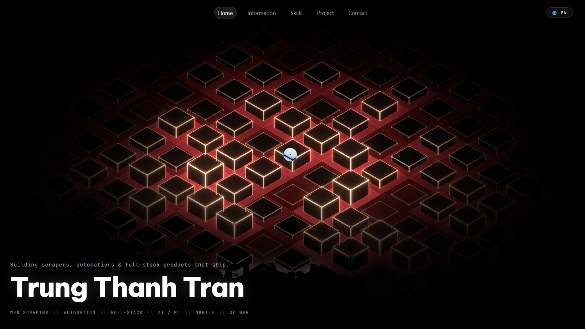
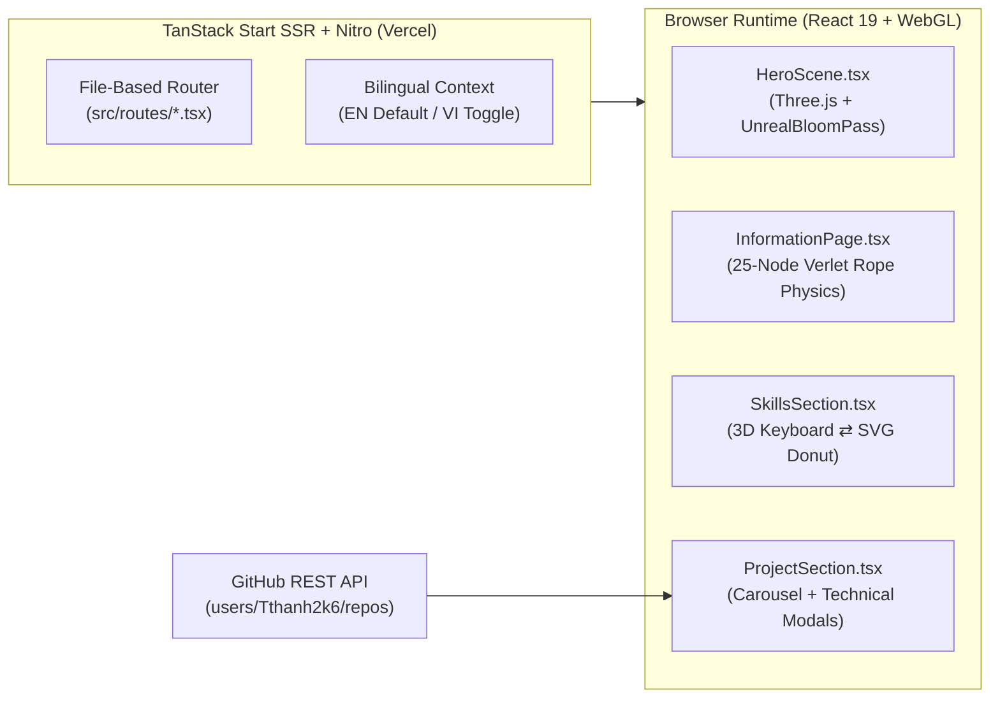

# Trung Thanh Tran — Interactive 3D WebGL Portfolio & Client-Side CMS

<div align="center">
  <a href="https://portfolio-red-theta-65.vercel.app/">
    
  </a>

  <br />

  <p align="center">
    <a href="https://portfolio-red-theta-65.vercel.app/">
      
    </a>
    <a href="https://portfolio-red-theta-65.vercel.app/cv">
      
    </a>
  </p>

  <p align="center">
    
    
    
    
    
  </p>
</div>

---

## ✨ Overview

An interactive, bilingual (`EN` / `VI`) full-stack developer portfolio built with **TanStack Start (SSR)**, **React 19**, **TypeScript**, **Three.js (WebGL)**, and **Tailwind CSS v4**. Designed to showcase engineering depth directly in the browser through real-time 3D rendering, custom physics simulations, and live GitHub REST API synchronization.

| Route | Interactive Highlights |
| :--- | :--- |
| **`/` (Home)** | Isometric 3D neon grid rendered with **Three.js + `UnrealBloomPass`**, interactive cursor raycasting, and damped spring blob cursor (`CustomCursor`). |
| **`/information`** | Custom **Verlet Integration** physics simulation (25-node rope + rigid-body developer ID badge with pointer drag & impulse response) alongside education, experience, and timeline cards. |
| **`/skills`** | Interactive **CSS `preserve-3d` Mechanical Keyboard** (24 keycaps mapped to core technologies) synchronized bidirectionally with an exploding **SVG Donut Chart**. |
| **`/project`** | Infinite **Film-Strip Carousel** combining commercial/private engineering case studies with live public repositories fetched dynamically from the **GitHub REST API (`users/Tthanh2k6/repos`)**, complete with two-tier executive & deep-dive technical modals. |
| **`/contact`** | Direct email integration (`FormSubmit`), interactive local guestbook, and social links. |
| **`/cv`** | Dedicated print-engineered **A4 Resume / CV** route (`@media print`) ready for one-click PDF export. |
| **`/admin`** | Client-side CMS gated by **Web Crypto API (`SHA-256`)** with `localStorage` persistence and `CONTENT_VERSION` cache invalidation. |

---

## 🏗️ Architecture



---

## 🚀 Quickstart

**Prerequisites:** Node.js **22.12+** and `npm`.

```powershell
git clone https://github.com/Tthanh2k6/Portfolio.git
cd Portfolio
npm ci
npm run dev
```

| Command | Description |
| :--- | :--- |
| `npm run dev` | Start Vite + TanStack Start development server |
| `npm run build` | Production SSR + client build (outputs `.vercel/output` via Nitro `vercel` preset) |
| `npm run preview` | Preview production build locally |
| `npm run lint` | Run ESLint static analysis |
| `npm run format` | Format codebase with Prettier |

---

## 📂 Project Structure

```text
Portfolio/
├── public/IMG/              # Highlight screenshots (1600×900) and static assets
├── src/
│   ├── components/          # 3D scenes, NavBar, CustomCursor, Skills, Projects & Modals
│   ├── routes/              # File-based routes (/, /information, /skills, /project, /contact, /cv, /admin)
│   ├── lib/                 # Bilingual i18n engine (en/vi) & utilities
│   ├── router.tsx           # TanStack Router configuration
│   └── server.ts            # SSR entry wrapper
├── CODEBASE.md              # Full architectural & source reference documentation
└── vite.config.ts           # Vite + TanStack Start + Nitro (Vercel preset) configuration
```

---

**Author:** **Trung Thanh Tran** (*Trần Trung Thành*) · [GitHub `@Tthanh2k6`](https://github.com/Tthanh2k6) · [Upwork Profile](https://www.upwork.com/freelancers/~01ee7c2348cb4b62fe)
