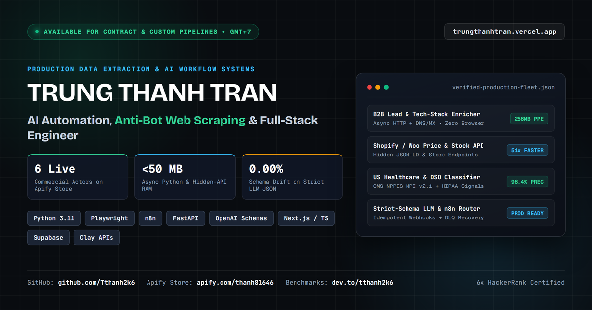

# Portfolio

Source of my portfolio site, https://trungthanhtran.vercel.app, in English and Vietnamese.

[](https://trungthanhtran.vercel.app/)

Built with TanStack Start (server rendering), React 19, TypeScript, Three.js and Tailwind CSS v4, deployed on Vercel.

## Pages

| Route | What is on it |
| --- | --- |
| `/` | A 3D grid drawn with Three.js and a bloom pass, reacting to the cursor |
| `/information` | Education, experience and a timeline, with an ID badge hanging from a rope you can drag (Verlet physics) |
| `/skills` | A 3D keyboard made with CSS transforms; pressing a key highlights its group in a donut chart |
| `/project` | Case studies plus my public GitHub repos, loaded live from the GitHub API |
| `/contact` | Contact form (sent through FormSubmit), a guestbook stored in the browser, social links |
| `/cv` | A one-page A4 CV with print styles, for saving as PDF |
| `/admin` | A small content editor in the browser. The password is checked against a SHA-256 hash and edits are saved to `localStorage`, so it only changes what that one browser shows. |

## Run it

```powershell
git clone https://github.com/Tthanh2k6/Portfolio.git
cd Portfolio
npm ci
npm run dev       # development server
npm run build     # production build for Vercel (.vercel/output)
npm run preview   # preview the build
```

`npm run lint` and `npm run format` run ESLint and Prettier.

## Layout

- `src/routes/`: one file per page
- `src/components/`: the 3D scenes, navigation, skills, projects and modals
- `src/lib/`: English and Vietnamese text and helpers
- `public/IMG/`: project screenshots
- `Idea Demo/`: early static HTML mock-ups of the pages

## Author

Trung Thanh Tran: [GitHub](https://github.com/Tthanh2k6) · [Apify Store](https://apify.com/thanh81646) · [dev.to](https://dev.to/tthanh2k6)
